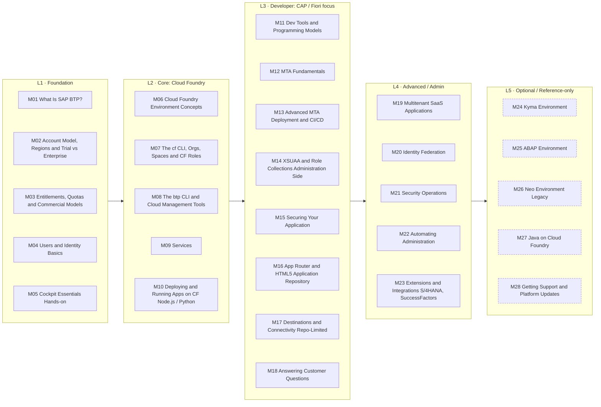

# 01 — SAP BTP Learning Syllabus

> **For:** a fresher full-stack developer at an SAP partner (CAP + Fiori on Cloud Foundry, plus Node.js) who has a Python/FastAPI/AWS background and works on Windows.
>
> **Built from:** the 2,065 pages in `btp-cloud-platform/docs/` (see [00-doc-map.md](00-doc-map.md)). Every page in the repo is assigned to a module, either as **core reading** (345 pages) or as **optional deep reference**. Coverage: **2065 / 2065 pages**.
>
> **Next step:** Phase 3 writes one lesson per module in `curriculum/modules/`, only when you say **"next"**. Progress is tracked in [progress.md](progress.md).

## How to read this syllabus

- **Levels** go from Foundation → Core → Developer → Advanced/Admin → Optional/Reference. Study in module order. The diagram shows the levels left to right; each module lists its exact prerequisites. Dashed boxes are awareness/reference-only.
- **Core source files** are the pages each lesson is based on. Read the lesson first, then open the originals. **Optional deep reference** covers everything else in that branch of the docs; use it as a lookup, not as reading homework.
- **Study time** = lesson notes, Q&A and quiz (~0.75 h) + reading the core source pages (at ~150 words/min, measured from the actual files) + hands-on in a BTP trial. Rounded up to the nearest half hour.
- **Awareness only** modules (dashed in the diagram) are for interview-level understanding: what it is, when it's used, how it compares. **Reference only** modules are lookups for when a project needs them. Neither has required hands-on.
- **Two kinds of questions in every lesson.** *Interview Q&A* tests your understanding. *Customer questions* are what a customer asks during delivery workshops or presentations ("why", "which", "what if", "who is responsible", "what does it cost"). Their answers are framed for business value: recommendation, then reason, then trade-off, then evidence. Anything that goes beyond this repo (pricing, competitive positioning, roadmap) is labelled as general knowledge to verify.
- **⚠️ Flags** mark gaps (topic mostly documented outside this repo) and pages that look outdated or conflicting. Each lesson says clearly where the repo stops.

## Your priority topics: where they are

| You asked for | Module(s) |
|---|---|
| Account model | M02 (concepts), M05 (cockpit hands-on) |
| Cloud Foundry | M06 (concepts), M07 (cf CLI, orgs, spaces), M09 (services), M10 (deploy & run) |
| Entitlements | M03 |
| XSUAA / role collections | M04 (basics), M14 (admin side), M15 (developer side: xs-security.json), M19 (IdP trust) |
| Destinations | M17 (⚠️ repo-limited), with App Router routes in M16 |
| MTA deployment | M12 (fundamentals), M13 (blue-green, CI/CD) |
| Business Application Studio | M11 (⚠️ repo-limited) |
| btp / cf CLIs | M08 (btp CLI), M07 (cf CLI) |
| Customer and interview "why / which" questions: BTP vs Azure/GCP, HANA Cloud vs PostgreSQL, CF vs Kyma vs ABAP, data residency, availability, cost, lock-in | A **Customer questions** section in every lesson · first look in M01, M06, M11 · capstone **M18** |

## Learning path

## All modules at a glance

| # | Level | Module | Core files | Study time |
|---|---|---|---:|---:|
| M01 | Foundation | What Is SAP BTP? | 10 | ~2 h |
| M02 | Foundation | Account Model, Regions & Trial vs Enterprise | 8 | ~2.5 h |
| M03 | Foundation | Entitlements, Quotas & Commercial Models | 8 | ~3 h |
| M04 | Foundation | Users & Identity Basics | 8 | ~2 h |
| M05 | Foundation | Cockpit Essentials (Hands-on) | 12 | ~3 h |
| M06 | Core: Cloud Foundry | Cloud Foundry Environment Concepts | 8 | ~2 h |
| M07 | Core: Cloud Foundry | The cf CLI, Orgs, Spaces & CF Roles | 15 | ~3.5 h |
| M08 | Core: Cloud Foundry | The btp CLI & Cloud Management Tools | 16 | ~3.5 h |
| M09 | Core: Cloud Foundry | Services: Instances, Bindings, Service Keys & VCAP_SERVICES | 17 | ~3 h |
| M10 | Core: Cloud Foundry | Deploying & Running Apps on CF (Node.js / Python) | 19 | ~4.5 h |
| M11 | Developer: CAP / Fiori focus | Dev Tools & Programming Models: BAS, CAP, SAP HANA | 11 | ~3 h |
| M12 | Developer: CAP / Fiori focus | MTA Fundamentals: mta.yaml, Build & Deploy | 14 | ~5.5 h |
| M13 | Developer: CAP / Fiori focus | Advanced MTA Deployment & CI/CD | 18 | ~4 h |
| M14 | Developer: CAP / Fiori focus | XSUAA & Role Collections (Administration Side) | 16 | ~3.5 h |
| M15 | Developer: CAP / Fiori focus | Securing Your Application: xs-security.json & Tokens | 16 | ~4.5 h |
| M16 | Developer: CAP / Fiori focus | App Router & HTML5 Application Repository | 22 | ~4.5 h |
| M17 | Developer: CAP / Fiori focus | Destinations & Connectivity (Repo-Limited) | 10 | ~2.5 h |
| M18 | Developer: CAP / Fiori focus | Answering Customer Questions: Platform Choices & Architecture Decisions | 2 | ~2.5 h |
| M19 | Advanced / Admin | Multitenant (SaaS) Applications | 16 | ~3.5 h |
| M20 | Advanced / Admin | Identity Federation: Corporate IdPs & SAP Cloud Identity Services | 20 | ~3.5 h |
| M21 | Advanced / Admin | Security Operations: Secrets, Audit Logging & Data Protection | 20 | ~3 h |
| M22 | Advanced / Admin | Automating Administration: APIs, Terraform, MCP & Joule | 13 | ~3 h |
| M23 | Advanced / Admin | Extensions & Integrations (S/4HANA, SuccessFactors) | 12 | ~3 h |
| M24 | Optional / Reference-only | Kyma Environment · *awareness only* | 13 | ~2 h |
| M25 | Optional / Reference-only | ABAP Environment · *awareness only* | 9 | ~1.5 h |
| M26 | Optional / Reference-only | Neo Environment (Legacy) · *awareness only* | 1 | ~1 h |
| M27 | Optional / Reference-only | Java on Cloud Foundry · *reference only* | 6 | ~1 h |
| M28 | Optional / Reference-only | Getting Support & Platform Updates · *reference only* | 5 | ~1 h |
| | | **Total** | **345** | **~81.5 h** |

**Time per level:** Foundation ~12.5 h · Core: Cloud Foundry ~16.5 h · Developer: CAP / Fiori focus ~30 h · Advanced / Admin ~16 h · Optional / Reference-only ~6.5 h

**Suggested pace:** at about 1.5 h a day alongside work, Levels 1–3 (the part that matters most for your job, ~59 h) take about 8 working weeks. The whole syllabus takes about 11 working weeks.

## Levels

- **L1 · Foundation:** What BTP is, how accounts and money work, who the users are. No coding yet.
- **L2 · Core: Cloud Foundry:** The runtime you will deploy to every day: CF concepts, both CLIs, services, running apps.
- **L3 · Developer: CAP / Fiori focus:** Building, securing, routing and shipping a real business app as an MTA.
- **L4 · Advanced / Admin:** SaaS, identity federation, security operations, automation, extensions.
- **L5 · Optional / Reference-only:** Other environments and deep references. Awareness level: know what they are and when they are used.

---

## Module details

### M01 · What Is SAP BTP?

**Level:** Foundation  ·  **Estimated study time:** ~2 h (lesson notes & Q&A ~0.75 h · source reading ~0.5 h · hands-on ~0.5 h)  ·  **Lesson file:** `modules/01-what-is-sap-btp.md`

**Why it matters:** Every interview starts here. Gives you the vocabulary (services, environments, programming models) that every later module uses.

**Learning objectives:** after this module you can…
- Explain what SAP BTP is and the problem it solves for SAP customers, in two sentences
- Name the four environments (Cloud Foundry, Kyma, ABAP, Neo) and say which one your team uses and why
- Distinguish services, applications and solutions on BTP
- Name the main tools (cockpit, btp CLI, cf CLI, BAS) and programming models (CAP, RAP)
- Give a first-look answer to "Why BTP and not just Azure/GCP?" (hint: BTP runs on them; full customer-ready answer in M18)

**Prerequisites:** None. Start here.

**Core source files** (10 files, ~4,201 words):

- [SAP Business Technology Platform](../btp-cloud-platform/docs/sap-business-technology-platform-6a2c1ab.md)
- [Basic Platform Concepts](../btp-cloud-platform/docs/10-concepts/basic-platform-concepts-73beb06.md)
- [Solutions and Services](../btp-cloud-platform/docs/10-concepts/solutions-and-services-7613d9c.md)
- [Environments](../btp-cloud-platform/docs/10-concepts/environments-15547f7.md)
- [Tools, Programming Models, Programming Languages, and APIs](../btp-cloud-platform/docs/10-concepts/tools-programming-models-programming-languages-and-apis-9b15170.md)
- [Tools](../btp-cloud-platform/docs/10-concepts/tools-abcae5b.md)
- [Programming Models](../btp-cloud-platform/docs/10-concepts/programming-models-042061d.md)
- [Programming Languages](../btp-cloud-platform/docs/10-concepts/programming-languages-730d82d.md)
- [APIs](../btp-cloud-platform/docs/10-concepts/apis-d1d1107.md)
- [Prerequisites and Restrictions](../btp-cloud-platform/docs/10-concepts/prerequisites-and-restrictions-e6ddaef.md)

**Optional deep reference:**

- Glossary (keep open while studying): [glossary-e67a143.md](../btp-cloud-platform/docs/glossary-e67a143.md)
- Section landing page: Getting Started: [getting-started-144e173.md](../btp-cloud-platform/docs/20-getting-started/getting-started-144e173.md)
- Section landing page: Development: [development-c2fec62.md](../btp-cloud-platform/docs/30-development/development-c2fec62.md)
- Section landing page: Administration and Operations: [administration-and-operations-e183664.md](../btp-cloud-platform/docs/50-administration-and-ops/administration-and-operations-e183664.md)
- Section landing page: Security: [security-e129aa2.md](../btp-cloud-platform/docs/60-security/security-e129aa2.md)
- Landing page: Account Administration: [account-administration-5d62ec8.md](../btp-cloud-platform/docs/50-administration-and-ops/account-administration-5d62ec8.md)
- Landing page: Developing Applications and Services: [developing-applications-and-services-68e2ece.md](../btp-cloud-platform/docs/30-development/developing-applications-and-services-68e2ece.md)
- Landing page: Administration and Operations in CF: [administration-and-operations-in-the-cloud-foundry-environment-a6b3b81.md](../btp-cloud-platform/docs/50-administration-and-ops/administration-and-operations-in-the-cloud-foundry-environment-a6b3b81.md)

---

### M02 · Account Model, Regions & Trial vs Enterprise

**Level:** Foundation  ·  **Estimated study time:** ~2.5 h (lesson notes & Q&A ~0.75 h · source reading ~0.7 h · hands-on ~1 h)  ·  **Lesson file:** `modules/02-account-model-and-regions.md`

**Why it matters:** The global account, directories, subaccounts and spaces hierarchy decides where your app lives, who can see it and who pays. Asked in nearly every BTP interview.

**Learning objectives:** after this module you can…
- Draw the hierarchy: global account → directories → subaccounts → environments (CF org → spaces)
- Explain what a region is and why a subaccount's region cannot be changed later
- Compare trial, free-tier and enterprise accounts and their limits
- Explain availability zones and the HA/DR responsibilities SAP vs you
- Create your own BTP trial account

**Prerequisites:** M01

**Core source files** (8 files, ~6,329 words):

- [Account Model](../btp-cloud-platform/docs/10-concepts/account-model-8ed4a70.md)
- [Regions](../btp-cloud-platform/docs/10-concepts/regions-350356d.md)
- [Regions and API Endpoints Available for the Cloud Foundry Environment](../btp-cloud-platform/docs/10-concepts/regions-and-api-endpoints-available-for-the-cloud-foundry-environment-f344a57.md) — *lookup table: skim*
- [Trial Accounts and Free Tier](../btp-cloud-platform/docs/10-concepts/trial-accounts-and-free-tier-046f127.md)
- [Enterprise Accounts](../btp-cloud-platform/docs/10-concepts/enterprise-accounts-171511c.md)
- [Resilience, High Availability, and Disaster Recovery](../btp-cloud-platform/docs/10-concepts/resilience-high-availability-and-disaster-recovery-e3ac4f7.md)
- [Getting a Global Account](../btp-cloud-platform/docs/20-getting-started/getting-a-global-account-d61c281.md)
- [Setting Up Your Trial Account](../btp-cloud-platform/docs/20-getting-started/setting-up-your-trial-account-fa5deb9.md)

**Optional deep reference:**

- Regions for the ABAP environment: [regions-and-api-endpoints-for-the-abap-environment-879f373.md](../btp-cloud-platform/docs/10-concepts/regions-and-api-endpoints-for-the-abap-environment-879f373.md)
- Regions for the Kyma environment: [regions-for-the-kyma-environment-557ec3a.md](../btp-cloud-platform/docs/10-concepts/regions-for-the-kyma-environment-557ec3a.md)

---

### M03 · Entitlements, Quotas & Commercial Models

**Level:** Foundation  ·  **Estimated study time:** ~3 h (lesson notes & Q&A ~0.75 h · source reading ~1.5 h · hands-on ~0.5 h)  ·  **Lesson file:** `modules/03-entitlements-quotas-commercial-models.md`

**Why it matters:** "Why can't I create this service instance?" is usually a missing entitlement. You will hit this in week one.

**Learning objectives:** after this module you can…
- Explain the difference between an entitlement and a quota with an analogy
- Compare consumption-based (CPEA / Pay-As-You-Go) and subscription-based commercial models
- Assign entitlements to a subaccount in the cockpit and find free service plans
- Read usage and cost information for a global account

**Prerequisites:** M02

**Core source files** (8 files, ~13,766 words):

- [Entitlements and Quotas](../btp-cloud-platform/docs/10-concepts/entitlements-and-quotas-00aa2c2.md)
- [Commercial Models](../btp-cloud-platform/docs/10-concepts/commercial-models-263d400.md)
- [What Is the Consumption-Based Commercial Model?](../btp-cloud-platform/docs/10-concepts/what-is-the-consumption-based-commercial-model-7047eb4.md)
- [What Is the Subscription-Based Commercial Model?](../btp-cloud-platform/docs/10-concepts/what-is-the-subscription-based-commercial-model-239b6e0.md)
- [Using Free Service Plans](../btp-cloud-platform/docs/10-concepts/using-free-service-plans-524e108.md)
- [Service Plans and Metering for Cloud Foundry Runtime](../btp-cloud-platform/docs/10-concepts/service-plans-and-metering-for-cloud-foundry-runtime-8d41fa4.md)
- [Managing Entitlements and Quotas Using the Cockpit](../btp-cloud-platform/docs/50-administration-and-ops/managing-entitlements-and-quotas-using-the-cockpit-c824874.md)
- [Monitoring Usage and Consumption Costs in Your Global Account](../btp-cloud-platform/docs/50-administration-and-ops/monitoring-usage-and-consumption-costs-in-your-global-account-de6f0db.md)

**Optional deep reference:**

- Managing budgets: [managing-budgets-in-your-global-account-e115d5f.md](../btp-cloud-platform/docs/50-administration-and-ops/managing-budgets-in-your-global-account-e115d5f.md)
- Usage Data Management service APIs: [monitoring-usage-information-using-apis-of-the-sap-usage-data-management-service-bf2b304.md](../btp-cloud-platform/docs/50-administration-and-ops/monitoring-usage-information-using-apis-of-the-sap-usage-data-management-service-bf2b304.md) (4 pages incl. sub-pages)
- Kyma metering: [service-plans-and-metering-for-kyma-runtime-c33bb11.md](../btp-cloud-platform/docs/10-concepts/service-plans-and-metering-for-kyma-runtime-c33bb11.md)
- ABAP metering: [service-plans-and-metering-for-sap-business-ai-platform-abap-environment-b7f5a93.md](../btp-cloud-platform/docs/10-concepts/service-plans-and-metering-for-sap-business-ai-platform-abap-environment-b7f5a93.md)

---

### M04 · Users & Identity Basics

**Level:** Foundation  ·  **Estimated study time:** ~2 h (lesson notes & Q&A ~0.75 h · source reading ~0.7 h · hands-on ~0.5 h)  ·  **Lesson file:** `modules/04-users-and-identity-basics.md`

**Why it matters:** Platform users vs business users, and scopes → roles → role collections, are the foundation of all BTP security work.

**Learning objectives:** after this module you can…
- Distinguish platform users (developers/admins) from business users (app end users)
- Explain the role of an identity provider (IdP) and of the default SAP ID service
- Describe the authorization chain: scope → role template → role → role collection → user
- Name the default role collections created for a new subaccount (e.g. Subaccount Administrator)

**Prerequisites:** M02

**Core source files** (8 files, ~6,608 words):

- [Introduction to Identity and Access Management on SAP BTP](../btp-cloud-platform/docs/10-concepts/introduction-to-identity-and-access-management-on-sap-btp-51c1677.md)
- [User and Member Management](../btp-cloud-platform/docs/10-concepts/user-and-member-management-cc1c676.md)
- [Platform Users](../btp-cloud-platform/docs/10-concepts/platform-users-4401316.md)
- [Business Users](../btp-cloud-platform/docs/10-concepts/business-users-2e68494.md)
- [What Is the SAP Authorization and Trust Management Service?](../btp-cloud-platform/docs/60-security/what-is-the-sap-authorization-and-trust-management-service-649961f.md)
- [Authorization Entities](../btp-cloud-platform/docs/60-security/authorization-entities-5d8ed75.md)
- [Default Role Collections of SAP BTP](../btp-cloud-platform/docs/60-security/default-role-collections-of-sap-btp-a6a0072.md)
- [Default Identity Provider](../btp-cloud-platform/docs/50-administration-and-ops/default-identity-provider-d6a8db7.md)

**Optional deep reference:**

- Web access control: [web-access-control-70a62d1.md](../btp-cloud-platform/docs/60-security/web-access-control-70a62d1.md)
- API access control: [api-access-control-3a23d64.md](../btp-cloud-platform/docs/60-security/api-access-control-3a23d64.md)

---

### M05 · Cockpit Essentials (Hands-on)

**Level:** Foundation  ·  **Estimated study time:** ~3 h (lesson notes & Q&A ~0.75 h · source reading ~0.5 h · hands-on ~1.5 h)  ·  **Lesson file:** `modules/05-cockpit-essentials.md`

**Why it matters:** The cockpit is the main UI for every admin task. This module turns M02 to M04 into muscle memory.

**Learning objectives:** after this module you can…
- Navigate global account, directory and subaccount levels in the cockpit
- Create a directory and a subaccount, add a member, enable the Cloud Foundry environment
- Change subaccount details and understand what deleting a subaccount destroys
- Know that Joule (AI assistant) can perform some admin tasks

**Prerequisites:** M02, M03, M04; A BTP trial account

**Core source files** (12 files, ~4,687 words):

- [Access the Cockpit](../btp-cloud-platform/docs/50-administration-and-ops/access-the-cockpit-4e75066.md)
- [Navigate in the Cockpit](../btp-cloud-platform/docs/50-administration-and-ops/navigate-in-the-cockpit-0874895.md)
- [Managing Global Accounts Using the Cockpit](../btp-cloud-platform/docs/50-administration-and-ops/managing-global-accounts-using-the-cockpit-667f34b.md)
- [Log On to Your Global Account](../btp-cloud-platform/docs/50-administration-and-ops/log-on-to-your-global-account-77be288.md)
- [Managing Directories Using the Cockpit](../btp-cloud-platform/docs/50-administration-and-ops/managing-directories-using-the-cockpit-f495ac1.md)
- [Create a Directory](../btp-cloud-platform/docs/50-administration-and-ops/create-a-directory-b8ef1c4.md)
- [Managing Subaccounts Using the Cockpit](../btp-cloud-platform/docs/50-administration-and-ops/managing-subaccounts-using-the-cockpit-55d0b6d.md)
- [Create a Subaccount](../btp-cloud-platform/docs/50-administration-and-ops/create-a-subaccount-05280a1.md)
- [Add Members to Your Subaccount](../btp-cloud-platform/docs/50-administration-and-ops/add-members-to-your-subaccount-1e1b7b6.md)
- [Enable Environment or Create Environment Instance](../btp-cloud-platform/docs/50-administration-and-ops/enable-environment-or-create-environment-instance-78c14b6.md)
- [Change Subaccount Details](../btp-cloud-platform/docs/50-administration-and-ops/change-subaccount-details-567d4a8.md)
- [Delete a Subaccount](../btp-cloud-platform/docs/50-administration-and-ops/delete-a-subaccount-419dc3d.md)

**Optional deep reference:**

- Account administration using Joule: [account-administration-using-joule-in-the-cockpit-3d7626b.md](../btp-cloud-platform/docs/50-administration-and-ops/account-administration-using-joule-in-the-cockpit-3d7626b.md) (6 pages incl. sub-pages)
- Everything under Account Administration in the Cockpit: [account-administration-in-the-cockpit-8061ecc.md](../btp-cloud-platform/docs/50-administration-and-ops/account-administration-in-the-cockpit-8061ecc.md) (111 pages incl. sub-pages)
- Getting started in CF (trial & enterprise paths): [getting-started-in-the-cloud-foundry-environment-b328cc8.md](../btp-cloud-platform/docs/20-getting-started/getting-started-in-the-cloud-foundry-environment-b328cc8.md) (6 pages incl. sub-pages)

---

### M06 · Cloud Foundry Environment Concepts

**Level:** Core: Cloud Foundry  ·  **Estimated study time:** ~2 h (lesson notes & Q&A ~0.75 h · source reading ~0.4 h · hands-on ~0.5 h)  ·  **Lesson file:** `modules/06-cloud-foundry-concepts.md`

**Why it matters:** CF is where your CAP and Node.js apps run. You must understand orgs, spaces, apps, buildpacks, routes and what SAP manages for you.

**Learning objectives:** after this module you can…
- Explain Cloud Foundry in simple terms ("you give it code, it gives you a running URL")
- Name which CF features SAP BTP supports and which it does not
- Explain BTP-specific CF configuration (limits, defaults) and availability zones
- Describe the shared-responsibility operating model: what SAP runs vs what you run
- Compare the CF and Kyma operating models at a high level
- Give a first-look answer to "When would you pick Cloud Foundry over Kyma or ABAP?" (full answer in M18)

**Prerequisites:** M02

**Core source files** (8 files, ~3,646 words):

- [Cloud Foundry Environment](../btp-cloud-platform/docs/10-concepts/cloud-foundry-environment-9c7092c.md)
- [Supported and Unsupported Cloud Foundry Features](../btp-cloud-platform/docs/10-concepts/supported-and-unsupported-cloud-foundry-features-f8a351c.md)
- [SAP BTP-Specific Configurations](../btp-cloud-platform/docs/10-concepts/sap-btp-specific-configurations-9809fa4.md)
- [Availability Zones in the Cloud Foundry Environment](../btp-cloud-platform/docs/10-concepts/availability-zones-in-the-cloud-foundry-environment-b6a7e11.md)
- [Additional Information About Cloud Foundry](../btp-cloud-platform/docs/10-concepts/additional-information-about-cloud-foundry-1c6cba8.md)
- [Operating Model in the Cloud Foundry Environment](../btp-cloud-platform/docs/70-getting-support/operating-model-in-the-cloud-foundry-environment-de55b6e.md)
- [Operating Model](../btp-cloud-platform/docs/70-getting-support/operating-model-9aafc94.md)
- [Development in the Cloud Foundry Environment](../btp-cloud-platform/docs/30-development/development-in-the-cloud-foundry-environment-40a8f8f.md)

**Optional deep reference:**

- Old CF vs Kyma comparison page (now a stub): [comparison-between-the-operating-models-of-kyma-and-cloud-foundry-runtimes-3978f94.md](../btp-cloud-platform/docs/70-getting-support/comparison-between-the-operating-models-of-kyma-and-cloud-foundry-runtimes-3978f94.md)

**⚠️ Flags:**

- STUB: 'Comparison between the Operating Models of Kyma and Cloud Foundry Runtimes' now only says the content has moved to 'Operating Model', which is used here instead.

---

### M07 · The cf CLI, Orgs, Spaces & CF Roles

**Level:** Core: Cloud Foundry  ·  **Estimated study time:** ~3.5 h (lesson notes & Q&A ~0.75 h · source reading ~0.6 h · hands-on ~2 h)  ·  **Lesson file:** `modules/07-cf-cli-orgs-spaces-roles.md`

**Why it matters:** Daily driver. `cf login`, `cf target`, `cf apps` and space roles (Space Developer) are used constantly, and a missing role is a top cause of "permission denied".

**Learning objectives:** after this module you can…
- Install the cf CLI on Windows and log in to your trial's API endpoint
- Create spaces, add org/space members and assign CF roles (Org Manager, Space Developer…)
- Explain how CF roles differ from BTP role collections
- Create and assign space quotas
- Install a cf CLI plug-in (you will need the MTA plug-in in M12)

**Prerequisites:** M05, M06

**Core source files** (15 files, ~5,073 words):

- [Download and Install the Cloud Foundry Command Line Interface](../btp-cloud-platform/docs/50-administration-and-ops/download-and-install-the-cloud-foundry-command-line-interface-4ef907a.md)
- [Log On to the Cloud Foundry Environment Using the Cloud Foundry Command Line Interface](../btp-cloud-platform/docs/50-administration-and-ops/log-on-to-the-cloud-foundry-environment-using-the-cloud-foundry-command-line-interface-7a37d66.md)
- [About User Management in the Cloud Foundry Environment](../btp-cloud-platform/docs/50-administration-and-ops/about-user-management-in-the-cloud-foundry-environment-8e6ce96.md)
- [About Roles in the Cloud Foundry Environment](../btp-cloud-platform/docs/50-administration-and-ops/about-roles-in-the-cloud-foundry-environment-0907638.md)
- [Navigate to Orgs and Spaces](../btp-cloud-platform/docs/50-administration-and-ops/navigate-to-orgs-and-spaces-5bf8735.md)
- [Managing Orgs](../btp-cloud-platform/docs/50-administration-and-ops/managing-orgs-fe1ebf3.md)
- [Managing Org Members](../btp-cloud-platform/docs/50-administration-and-ops/managing-org-members-b792066.md)
- [Managing Spaces](../btp-cloud-platform/docs/50-administration-and-ops/managing-spaces-5209d55.md)
- [Managing Space Members](../btp-cloud-platform/docs/50-administration-and-ops/managing-space-members-5ab7738.md)
- [Managing Space Quotas](../btp-cloud-platform/docs/50-administration-and-ops/managing-space-quotas-4e5f0ee.md)
- [Create Spaces Using the Cloud Foundry Command Line Interface](../btp-cloud-platform/docs/50-administration-and-ops/create-spaces-using-the-cloud-foundry-command-line-interface-a2e5e29.md)
- [Add Space Members Using the Cloud Foundry Command Line Interface](../btp-cloud-platform/docs/50-administration-and-ops/add-space-members-using-the-cloud-foundry-command-line-interface-d23ea8b.md)
- [Add Organization Members Using the Cloud Foundry Command Line Interface](../btp-cloud-platform/docs/50-administration-and-ops/add-organization-members-using-the-cloud-foundry-command-line-interface-1422a5d.md)
- [Org Management Using the SAP BTP Command Line Interface (btp CLI)](../btp-cloud-platform/docs/50-administration-and-ops/org-management-using-the-sap-btp-command-line-interface-btp-cli-aee40e1.md)
- [CF CLI: Plug-ins](../btp-cloud-platform/docs/50-administration-and-ops/cf-cli-plug-ins-dc28ce3.md)

**Optional deep reference:**

- Org administration using the cockpit: [org-administration-using-the-cockpit-c4c25cc.md](../btp-cloud-platform/docs/50-administration-and-ops/org-administration-using-the-cockpit-c4c25cc.md) (21 pages incl. sub-pages)
- Org administration using the cf CLI: [org-administration-using-the-cloud-foundry-cli-927377f.md](../btp-cloud-platform/docs/50-administration-and-ops/org-administration-using-the-cloud-foundry-cli-927377f.md) (26 pages incl. sub-pages)
- Autoscaler plug-in: [autoscaler-plugin-for-cloud-foundry-cli-abb810d.md](../btp-cloud-platform/docs/50-administration-and-ops/autoscaler-plugin-for-cloud-foundry-cli-abb810d.md) (2 pages incl. sub-pages)
- Migrating a CF environment instance to SAP Build: [migrating-cloud-foundry-environment-instance-to-sap-build-0751a24.md](../btp-cloud-platform/docs/50-administration-and-ops/migrating-cloud-foundry-environment-instance-to-sap-build-0751a24.md)

**⚠️ Flags:**

- The docs mention `cf6`, `cf7` and `cf8`. The lesson will pin commands to the current CLI version and call out differences.

---

### M08 · The btp CLI & Cloud Management Tools

**Level:** Core: Cloud Foundry  ·  **Estimated study time:** ~3.5 h (lesson notes & Q&A ~0.75 h · source reading ~1.2 h · hands-on ~1.5 h)  ·  **Lesson file:** `modules/08-btp-cli.md`

**Why it matters:** The btp CLI scripts what the cockpit does (subaccounts, entitlements, role collections). It's the command-line counterpart to `cf`, at the account level.

**Learning objectives:** after this module you can…
- Explain when to use cockpit vs btp CLI vs REST APIs vs Terraform
- Install the btp CLI on Windows, log in (including SSO) and set a target
- Create a subaccount, assign entitlements and assign role collections from the CLI
- Use JSON output for scripting
- Explain the difference between `btp` (account level) and `cf` (inside a CF org)

**Prerequisites:** M05, M07

**Core source files** (16 files, ~10,589 words):

- [Cloud Management Tools](../btp-cloud-platform/docs/10-concepts/cloud-management-tools-caf4e4e.md)
- [Account Administration Using the SAP BTP Command Line Interface (btp CLI)](../btp-cloud-platform/docs/50-administration-and-ops/account-administration-using-the-sap-btp-command-line-interface-btp-cli-7c6df2d.md)
- [Download and Start Using the btp CLI Client](../btp-cloud-platform/docs/50-administration-and-ops/download-and-start-using-the-btp-cli-client-8a8f17f.md)
- [Command Syntax of the btp CLI](../btp-cloud-platform/docs/50-administration-and-ops/command-syntax-of-the-btp-cli-69606f4.md)
- [How to Work with the btp CLI](../btp-cloud-platform/docs/50-administration-and-ops/how-to-work-with-the-btp-cli-11d9f67.md)
- [Log in](../btp-cloud-platform/docs/50-administration-and-ops/log-in-e241b30.md)
- [Log in with Single Sign-On](../btp-cloud-platform/docs/50-administration-and-ops/log-in-with-single-sign-on-b2a56a8.md)
- [Set a Target for Subsequent Commands with btp target](../btp-cloud-platform/docs/50-administration-and-ops/set-a-target-for-subsequent-commands-with-btp-target-720645a.md)
- [Change the Output Format to JSON](../btp-cloud-platform/docs/50-administration-and-ops/change-the-output-format-to-json-dcb85b7.md)
- [Commands in the btp CLI](../btp-cloud-platform/docs/50-administration-and-ops/commands-in-the-btp-cli-a03a555.md)
- [Working with Global Accounts, Directories, and Subaccounts Using the btp CLI](../btp-cloud-platform/docs/50-administration-and-ops/working-with-global-accounts-directories-and-subaccounts-using-the-btp-cli-85a683e.md)
- [Setting Entitlements Using the btp CLI](../btp-cloud-platform/docs/50-administration-and-ops/setting-entitlements-using-the-btp-cli-5af849c.md)
- [Working with Environments Using the btp CLI](../btp-cloud-platform/docs/50-administration-and-ops/working-with-environments-using-the-btp-cli-48db155.md)
- [Managing Users and Their Authorizations Using the btp CLI](../btp-cloud-platform/docs/50-administration-and-ops/managing-users-and-their-authorizations-using-the-btp-cli-94bb593.md)
- [Setting Up a Trial Account From the Command Line](../btp-cloud-platform/docs/20-getting-started/setting-up-a-trial-account-from-the-command-line-a21360f.md)
- [Setting Up a Global Account via the Command Line](../btp-cloud-platform/docs/20-getting-started/setting-up-a-global-account-via-the-command-line-accd5b2.md)

**Optional deep reference:**

- Full btp CLI documentation: [account-administration-using-the-sap-btp-command-line-interface-btp-cli-7c6df2d.md](../btp-cloud-platform/docs/50-administration-and-ops/account-administration-using-the-sap-btp-command-line-interface-btp-cli-7c6df2d.md) (33 pages incl. sub-pages)
- btp CLI troubleshooting: [troubleshooting-for-the-btp-cli-4023e15.md](../btp-cloud-platform/docs/50-administration-and-ops/troubleshooting-for-the-btp-cli-4023e15.md)

---

### M09 · Services: Instances, Bindings, Service Keys & VCAP_SERVICES

**Level:** Core: Cloud Foundry  ·  **Estimated study time:** ~3 h (lesson notes & Q&A ~0.75 h · source reading ~0.3 h · hands-on ~1.5 h)  ·  **Lesson file:** `modules/09-cf-services.md`

**Why it matters:** Every BTP app consumes services (XSUAA, HANA, destination, HTML5 repo…). Instance → binding → credentials in VCAP_SERVICES is the core pattern.

**Learning objectives:** after this module you can…
- Explain service, plan, instance, binding and service key, with an analogy
- Create a service instance and bind it to an app, both in the cockpit and with the cf CLI
- Read the credentials an app receives (VCAP_SERVICES) and explain why you never hard-code them
- Create a service key for local or external access, and a user-provided service
- Update and delete service instances safely

**Prerequisites:** M03, M07

**Core source files** (17 files, ~2,772 words):

- [Using Services in the Cloud Foundry Environment](../btp-cloud-platform/docs/30-development/using-services-in-the-cloud-foundry-environment-f22029f.md)
- [About Services](../btp-cloud-platform/docs/30-development/about-services-d1d0fc8.md)
- [Creating Service Instances](../btp-cloud-platform/docs/30-development/creating-service-instances-8221b74.md)
- [Create Service Instances Using the Cockpit](../btp-cloud-platform/docs/30-development/create-service-instances-using-the-cockpit-5516f91.md)
- [Create Service Instances Using the Cloud Foundry Command Line Interface](../btp-cloud-platform/docs/30-development/create-service-instances-using-the-cloud-foundry-command-line-interface-a872531.md)
- [Binding Service Instances to Applications](../btp-cloud-platform/docs/30-development/binding-service-instances-to-applications-e98280a.md)
- [Bind Service Instances to Applications Using the Cockpit](../btp-cloud-platform/docs/30-development/bind-service-instances-to-applications-using-the-cockpit-2d2a3e8.md)
- [Bind Service Instances to Applications Using the Cloud Foundry Command Line Interface](../btp-cloud-platform/docs/30-development/bind-service-instances-to-applications-using-the-cloud-foundry-command-line-interface-296cd59.md)
- [Creating Service Keys](../btp-cloud-platform/docs/30-development/creating-service-keys-4514a14.md)
- [Create Service Keys Using the Cockpit](../btp-cloud-platform/docs/30-development/create-service-keys-using-the-cockpit-cdf4f20.md)
- [Create Service Keys Using the Cloud Foundry Command Line Interface](../btp-cloud-platform/docs/30-development/create-service-keys-using-the-cloud-foundry-command-line-interface-7de6b31.md)
- [Creating User-Provided Service Instances](../btp-cloud-platform/docs/30-development/creating-user-provided-service-instances-a44355e.md)
- [Create User-Provided Service Instances Using the Cloud Foundry Command Line Interface](../btp-cloud-platform/docs/30-development/create-user-provided-service-instances-using-the-cloud-foundry-command-line-interface-d3c73f1.md)
- [Updating Service Instances](../btp-cloud-platform/docs/30-development/updating-service-instances-83417a5.md)
- [Deleting Service Instances](../btp-cloud-platform/docs/30-development/deleting-service-instances-aa0d25a.md)
- [Boosters](../btp-cloud-platform/docs/30-development/boosters-fb1b561.md)
- [Bind an Application to a Service](../btp-cloud-platform/docs/50-administration-and-ops/bind-an-application-to-a-service-6eb987f.md)

**Optional deep reference:**

- Sharing service instances across spaces: [sharing-and-unsharing-service-instances-8915127.md](../btp-cloud-platform/docs/30-development/sharing-and-unsharing-service-instances-8915127.md)
- Update service instances: [update-service-instances-using-the-sap-btp-cockpit-or-cloud-foundry-command-line-interfac-54fe2e7.md](../btp-cloud-platform/docs/30-development/update-service-instances-using-the-sap-btp-cockpit-or-cloud-foundry-command-line-interfac-54fe2e7.md)
- All service pages (cockpit + CLI variants): [using-services-in-the-cloud-foundry-environment-f22029f.md](../btp-cloud-platform/docs/30-development/using-services-in-the-cloud-foundry-environment-f22029f.md) (20 pages incl. sub-pages)

---

### M10 · Deploying & Running Apps on CF (Node.js / Python)

**Level:** Core: Cloud Foundry  ·  **Estimated study time:** ~4.5 h (lesson notes & Q&A ~0.75 h · source reading ~0.8 h · hands-on ~2.5 h)  ·  **Lesson file:** `modules/10-deploy-and-run-cf-apps.md`

**Why it matters:** Push an app, read its logs, fix a crash, scale it. This is the operational loop you will repeat for every project.

**Learning objectives:** after this module you can…
- Deploy a small Node.js app with `cf push` and explain what the buildpack does
- Set environment variables, restart vs restage, and scale instances and memory
- Read app logs and events to troubleshoot a failing app
- Map routes and understand app URLs and domains
- Apply the documented Node.js and Python tips and troubleshooting steps

**Prerequisites:** M07, M09; Basic Node.js (you have Python and FastAPI; Node is similar)

**Core source files** (19 files, ~7,408 words):

- [Developing Your First Application](../btp-cloud-platform/docs/30-development/developing-your-first-application-bc8d5c0.md)
- [Best Practices](../btp-cloud-platform/docs/30-development/best-practices-0859096.md)
- [Development Languages](../btp-cloud-platform/docs/30-development/development-languages-2d0ff22.md)
- [Developing Node.js in the Cloud Foundry Environment](../btp-cloud-platform/docs/30-development/developing-node-js-in-the-cloud-foundry-environment-3a7a0be.md)
- [Tips and Tricks for Node.js Applications](../btp-cloud-platform/docs/30-development/tips-and-tricks-for-node-js-applications-3a5fe88.md)
- [Node.js Buildpack: Troubleshooting](../btp-cloud-platform/docs/30-development/node-js-buildpack-troubleshooting-1462ff0.md)
- [Developing Python in the Cloud Foundry Environment](../btp-cloud-platform/docs/30-development/developing-python-in-the-cloud-foundry-environment-acf8f49.md)
- [Tips and Tricks for Python Applications](../btp-cloud-platform/docs/30-development/tips-and-tricks-for-python-applications-b5e1c82.md)
- [Application Operations in the Cloud Foundry Environment](../btp-cloud-platform/docs/50-administration-and-ops/application-operations-in-the-cloud-foundry-environment-0f1286a.md)
- [Deploy an Application](../btp-cloud-platform/docs/50-administration-and-ops/deploy-an-application-09fdb9b.md)
- [Manage Environment Variables](../btp-cloud-platform/docs/50-administration-and-ops/manage-environment-variables-9984a29.md)
- [Start, Stop, and Restart Applications](../btp-cloud-platform/docs/50-administration-and-ops/start-stop-and-restart-applications-c0d7b6b.md)
- [Restage an Application](../btp-cloud-platform/docs/50-administration-and-ops/restage-an-application-26255c4.md)
- [Manage Application Instances](../btp-cloud-platform/docs/50-administration-and-ops/manage-application-instances-75836f1.md)
- [Troubleshoot Applications](../btp-cloud-platform/docs/50-administration-and-ops/troubleshoot-applications-2ae6772.md)
- [Using Application Events](../btp-cloud-platform/docs/50-administration-and-ops/using-application-events-f086817.md)
- [Using Application Logs](../btp-cloud-platform/docs/50-administration-and-ops/using-application-logs-4c403b5.md)
- [Configuring Application URLs in the Cloud Foundry CLI](../btp-cloud-platform/docs/50-administration-and-ops/configuring-application-urls-in-the-cloud-foundry-cli-e623e37.md)
- [About Routes in the Cockpit](../btp-cloud-platform/docs/50-administration-and-ops/about-routes-in-the-cockpit-4af288c.md)

**Optional deep reference:**

- Security groups: [security-groups-6548232.md](../btp-cloud-platform/docs/50-administration-and-ops/security-groups-6548232.md)
- Custom domains: [using-custom-domains-2291aea.md](../btp-cloud-platform/docs/50-administration-and-ops/using-custom-domains-2291aea.md)
- Python buildpack troubleshooting: [python-buildpack-troubleshooting-caaf1dc.md](../btp-cloud-platform/docs/30-development/python-buildpack-troubleshooting-caaf1dc.md)
- General troubleshooting: [troubleshooting-073b7fc.md](../btp-cloud-platform/docs/30-development/troubleshooting-073b7fc.md)
- Routes in the cockpit (create, map, bind): [about-routes-in-the-cockpit-4af288c.md](../btp-cloud-platform/docs/50-administration-and-ops/about-routes-in-the-cockpit-4af288c.md) (4 pages incl. sub-pages)

---

### M11 · Dev Tools & Programming Models: BAS, CAP, SAP HANA

**Level:** Developer: CAP / Fiori focus  ·  **Estimated study time:** ~3 h (lesson notes & Q&A ~0.75 h · source reading ~0.4 h · hands-on ~1.5 h)  ·  **Lesson file:** `modules/11-dev-tools-bas-cap.md`

**Why it matters:** Your team builds with CAP + Fiori in Business Application Studio. This module maps those tools onto BTP, and shows how thin this repo's coverage of them is.

**Learning objectives:** after this module you can…
- Explain what SAP Business Application Studio is and why it replaced SAP Web IDE
- Explain the business application pattern (UI + service + DB + XSUAA + App Router)
- Describe CAP at a high level (CDS models, services, Node.js/Java runtimes)
- Know where the real CAP, BAS and HANA documentation lives (outside this repo)
- Follow the documented flow: develop a Fiori app in BAS and deploy it to CF
- Give a first-look answer to "SAP HANA Cloud or PostgreSQL?" (full answer in M18)

**Prerequisites:** M10

**Core source files** (11 files, ~3,913 words):

- [SAP Business Application Studio](../btp-cloud-platform/docs/30-development/sap-business-application-studio-c736960.md)
- [Business Application Pattern](../btp-cloud-platform/docs/30-development/business-application-pattern-a1de162.md)
- [Developing with the SAP Cloud Application Programming Model](../btp-cloud-platform/docs/30-development/developing-with-the-sap-cloud-application-programming-model-00823f9.md)
- [Developing Business Applications Using Node.js](../btp-cloud-platform/docs/30-development/developing-business-applications-using-node-js-29c25e5.md)
- [Core Data Services (CDS) Language Reference Documentation](../btp-cloud-platform/docs/30-development/core-data-services-cds-language-reference-documentation-855e00b.md)
- [Best Practices](../btp-cloud-platform/docs/30-development/best-practices-e4a7559.md)
- [References](../btp-cloud-platform/docs/30-development/references-d2ee648.md)
- [Developing SAP HANA in the Cloud Foundry Environment](../btp-cloud-platform/docs/30-development/developing-sap-hana-in-the-cloud-foundry-environment-14224d7.md)
- [Setting Up Database Artifacts](../btp-cloud-platform/docs/30-development/setting-up-database-artifacts-3cd6954.md)
- [Consuming APIs](../btp-cloud-platform/docs/30-development/consuming-apis-d4cae3e.md)
- [Develop an SAP Fiori Application and Deploy it to Cloud Foundry Using SAP Business Application Studio](../btp-cloud-platform/docs/30-development/develop-an-sap-fiori-application-and-deploy-it-to-cloud-foundry-using-sap-business-applic-2498cbf.md)

**Optional deep reference:**

- CAP with Java: [developing-business-applications-using-java-9186ed9.md](../btp-cloud-platform/docs/30-development/developing-business-applications-using-java-9186ed9.md)
- Subscribing to BAS (ABAP-environment context): [subscribing-to-sap-business-application-studio-0a9b42e.md](../btp-cloud-platform/docs/20-getting-started/subscribing-to-sap-business-application-studio-0a9b42e.md)

**⚠️ Flags:**

- GAP: BAS has 1 overview page, and CAP has 6 pages that mostly point to capire (cap.cloud.sap). The lesson will teach the BTP-side concepts only and say clearly where the repo stops.
- OUTDATED: about 21 files still mention SAP Web IDE (Neo-era). 'Developing SAP HANA in the CF environment' still links a modeling guide written for Web IDE.
- CHECK: 'Business Application Pattern' lists MongoDB, Redis and RabbitMQ as backing services. That list looks older than the current service catalogue, so verify it in SAP Discovery Center.

---

### M12 · MTA Fundamentals: mta.yaml, Build & Deploy

**Level:** Developer: CAP / Fiori focus  ·  **Estimated study time:** ~5.5 h (lesson notes & Q&A ~0.75 h · source reading ~1.8 h · hands-on ~2.5 h)  ·  **Lesson file:** `modules/12-mta-fundamentals.md`

**Why it matters:** Every CAP/Fiori project ships as a Multitarget Application. Reading and writing mta.yaml is a core skill and a favourite interview topic.

**Learning objectives:** after this module you can…
- Explain what an MTA is and why it beats pushing apps one by one
- Read an mta.yaml: modules, resources, requires/provides, parameters vs properties
- Explain development descriptor (mta.yaml) vs deployment descriptor vs extension descriptor (.mtaext)
- Build an .mtar and deploy it with `cf deploy` using the MTA plug-in
- Use an extension descriptor to vary config per space (dev/test/prod)

**Prerequisites:** M09, M10

**Core source files** (14 files, ~16,621 words):

- [Deploying to the Cloud Foundry Environment](../btp-cloud-platform/docs/30-development/deploying-to-the-cloud-foundry-environment-2a21055.md)
- [Multitarget Applications in the Cloud Foundry Environment](../btp-cloud-platform/docs/30-development/multitarget-applications-in-the-cloud-foundry-environment-d04fc0e.md)
- [Benefits of the Multitarget Application Model for the Cloud Foundry Environment](../btp-cloud-platform/docs/30-development/benefits-of-the-multitarget-application-model-for-the-cloud-foundry-environment-8d2a68a.md)
- [Getting Started](../btp-cloud-platform/docs/30-development/getting-started-0ce9938.md)
- [Defining Multitarget Application Development Descriptors](../btp-cloud-platform/docs/30-development/defining-multitarget-application-development-descriptors-c2d31e7.md)
- [Defining Multitarget Application Archives](../btp-cloud-platform/docs/30-development/defining-multitarget-application-archives-33a0e0e.md)
- [Defining Multitarget Application Deployment Descriptors for Cloud Foundry](../btp-cloud-platform/docs/30-development/defining-multitarget-application-deployment-descriptors-for-cloud-foundry-f48880b.md)
- [MTA Deployment Descriptor Examples](../btp-cloud-platform/docs/30-development/mta-deployment-descriptor-examples-66a7033.md)
- [Multitarget Application Structure](../btp-cloud-platform/docs/30-development/multitarget-application-structure-f443b9f.md)
- [Modules](../btp-cloud-platform/docs/30-development/modules-177d34d.md)
- [Resources](../btp-cloud-platform/docs/30-development/resources-9e34487.md)
- [Parameters and Properties](../btp-cloud-platform/docs/30-development/parameters-and-properties-490c8f7.md)
- [Defining MTA Extension Descriptors](../btp-cloud-platform/docs/30-development/defining-mta-extension-descriptors-50df803.md)
- [Multitarget Application Plugin for Cloud Foundry Command Line Interface](../btp-cloud-platform/docs/50-administration-and-ops/multitarget-application-plugin-for-cloud-foundry-command-line-interface-e93b231.md)

**Optional deep reference:**

- List of supported MTA parameters (lookup table): [list-of-supported-mta-parameters-6aa426e.md](../btp-cloud-platform/docs/30-development/list-of-supported-mta-parameters-6aa426e.md)
- Metadata for properties & parameters: [metadata-for-properties-and-parameters-fca2ced.md](../btp-cloud-platform/docs/30-development/metadata-for-properties-and-parameters-fca2ced.md)
- Module hooks: [module-hooks-b9245ba.md](../btp-cloud-platform/docs/30-development/module-hooks-b9245ba.md)
- BTP capabilities in MTAs: apps, services, routes, tasks, Docker: [sap-business-technology-platform-capabilities-1d6f3ca.md](../btp-cloud-platform/docs/30-development/sap-business-technology-platform-capabilities-1d6f3ca.md) (11 pages incl. sub-pages)

**⚠️ Flags:**

- OUTDATED EXAMPLE: 'Resources' shows a PostgreSQL resource with service plan `v9.6-dev` (PostgreSQL 9.6 is long out of support), and the same page marks the `org.postgresql` resource type as deprecated in favour of `postgresql`.

---

### M13 · Advanced MTA Deployment & CI/CD

**Level:** Developer: CAP / Fiori focus  ·  **Estimated study time:** ~4 h (lesson notes & Q&A ~0.75 h · source reading ~1.3 h · hands-on ~1.5 h)  ·  **Lesson file:** `modules/13-mta-advanced-and-cicd.md`

**Why it matters:** Zero-downtime (blue-green) deploys, cross-MTA dependencies, secrets in deployment and CI/CD are what production releases need.

**Learning objectives:** after this module you can…
- Explain blue-green deployment and choose between the current strategies
- Use namespaces, parallel module deployment and cross-MTA dependencies
- Handle sensitive data safely during MTA deployment
- Read MTA operation history and logs to troubleshoot a failed deploy
- Explain CI/CD on BTP at a conceptual level

**Prerequisites:** M12

**Core source files** (18 files, ~11,399 words):

- [Features](../btp-cloud-platform/docs/30-development/features-d50d040.md)
- [Blue-Green Deployment of Multitarget Applications](../btp-cloud-platform/docs/30-development/blue-green-deployment-of-multitarget-applications-772ab72.md)
- [Blue-Green Deployment Strategy](../btp-cloud-platform/docs/30-development/blue-green-deployment-strategy-7c83810.md)
- [Incremental Blue-Green Deployment Strategy](../btp-cloud-platform/docs/30-development/incremental-blue-green-deployment-strategy-2e4dfed.md)
- [Legacy Blue-Green Deployment](../btp-cloud-platform/docs/30-development/legacy-blue-green-deployment-764308c.md)
- [(Experimental) Rollback of Multitarget Applications](../btp-cloud-platform/docs/30-development/experimental-rollback-of-multitarget-applications-d612be9.md)
- [Namespaces](../btp-cloud-platform/docs/30-development/namespaces-b28fd77.md)
- [Parallel Module Deployment](../btp-cloud-platform/docs/30-development/parallel-module-deployment-0384158.md)
- [Cross-MTA Dependencies](../btp-cloud-platform/docs/30-development/cross-mta-dependencies-b8e1953.md)
- [Sensitive Data Handling During MTA Deployment](../btp-cloud-platform/docs/30-development/sensitive-data-handling-during-mta-deployment-4c40fda.md)
- [MTA Operations History and Logs](../btp-cloud-platform/docs/30-development/mta-operations-history-and-logs-c55d858.md)
- [Content Deployment](../btp-cloud-platform/docs/30-development/content-deployment-68d0da8.md)
- [Frequently Asked Questions](../btp-cloud-platform/docs/30-development/frequently-asked-questions-6062ecc.md)
- [Troubleshooting](../btp-cloud-platform/docs/30-development/troubleshooting-3530af7.md)
- [MTA Operation Failure](../btp-cloud-platform/docs/30-development/mta-operation-failure-f3e97ff.md)
- [Continuous Integration and Delivery (CI/CD)](../btp-cloud-platform/docs/10-concepts/continuous-integration-and-delivery-ci-cd-fe74df5.md)
- [Continuous Integration and Delivery](../btp-cloud-platform/docs/30-development/continuous-integration-and-delivery-fdead30.md)
- [Deploy Business Applications in the Cloud Foundry Environment](../btp-cloud-platform/docs/30-development/deploy-business-applications-in-the-cloud-foundry-environment-4946ea5.md)

**Optional deep reference:**

- Deploy Docker images: [deploy-docker-images-in-the-cloud-foundry-environment-c190ad6.md](../btp-cloud-platform/docs/30-development/deploy-docker-images-in-the-cloud-foundry-environment-c190ad6.md)
- Integration with SAP Cloud Deployment service: [integration-d0e097c.md](../btp-cloud-platform/docs/30-development/integration-d0e097c.md) (6 pages incl. sub-pages)
- MTA deployment in China regions: [mta-deployment-in-regions-china-shanghai-and-china-north-3-f463c3d.md](../btp-cloud-platform/docs/30-development/mta-deployment-in-regions-china-shanghai-and-china-north-3-f463c3d.md)
- All MTA pages (59): [multitarget-applications-in-the-cloud-foundry-environment-d04fc0e.md](../btp-cloud-platform/docs/30-development/multitarget-applications-in-the-cloud-foundry-environment-d04fc0e.md) (59 pages incl. sub-pages)

**⚠️ Flags:**

- CONFLICT TO CHECK: 'Legacy Blue-Green Deployment' sits alongside two newer strategies, plus an '(Experimental) Rollback' page.
- GAP: CI/CD has only 2 overview pages here. The CI/CD service has its own documentation set.

---

### M14 · XSUAA & Role Collections (Administration Side)

**Level:** Developer: CAP / Fiori focus  ·  **Estimated study time:** ~3.5 h (lesson notes & Q&A ~0.75 h · source reading ~1.0 h · hands-on ~1.5 h)  ·  **Lesson file:** `modules/14-xsuaa-and-role-collections.md`

**Why it matters:** Getting the right user into the right role collection is half of every "403 Forbidden" ticket. This is the admin view of BTP authorization.

**Learning objectives:** after this module you can…
- Explain what XSUAA (SAP Authorization and Trust Management service) does in the OAuth 2.0 flow
- Define a role collection, add roles and assign it to users or user groups
- Create roles from an app's role templates, including attributes
- Map role collections to IdP groups
- Find a user's role collections and troubleshoot missing authorizations

**Prerequisites:** M04, M05

**Core source files** (16 files, ~8,609 words):

- [SAP Authorization and Trust Management Service](../btp-cloud-platform/docs/60-security/sap-authorization-and-trust-management-service-6373bb7.md)
- [Role Collections and Roles in Global Accounts, Directories, and Subaccounts](../btp-cloud-platform/docs/10-concepts/role-collections-and-roles-in-global-accounts-directories-and-subaccounts-0039cf0.md)
- [Web Access Control](../btp-cloud-platform/docs/60-security/web-access-control-70a62d1.md)
- [API Access Control](../btp-cloud-platform/docs/60-security/api-access-control-3a23d64.md)
- [Working with Role Collections](../btp-cloud-platform/docs/50-administration-and-ops/working-with-role-collections-393ea0b.md)
- [Define a Role Collection](../btp-cloud-platform/docs/50-administration-and-ops/define-a-role-collection-4b20383.md)
- [Assigning Role Collections to Users or User Groups](../btp-cloud-platform/docs/50-administration-and-ops/assigning-role-collections-to-users-or-user-groups-31532c7.md)
- [Mapping Role Collections](../btp-cloud-platform/docs/50-administration-and-ops/mapping-role-collections-9e1bf57.md)
- [Building Roles and Role Collections for Applications](../btp-cloud-platform/docs/50-administration-and-ops/building-roles-and-role-collections-for-applications-eaa6a26.md)
- [Roles and Role Collections](../btp-cloud-platform/docs/50-administration-and-ops/roles-and-role-collections-14a877c.md)
- [Create Roles for Applications Using Existing Role Templates](../btp-cloud-platform/docs/50-administration-and-ops/create-roles-for-applications-using-existing-role-templates-2670fd2.md)
- [Add Roles to Role Collections on the Application Level](../btp-cloud-platform/docs/50-administration-and-ops/add-roles-to-role-collections-on-the-application-level-7596a0b.md)
- [Attributes](../btp-cloud-platform/docs/50-administration-and-ops/attributes-713f52a.md)
- [Working with Users](../btp-cloud-platform/docs/50-administration-and-ops/working-with-users-2c91f88.md)
- [Find Users and Their Role Collection Assignments](../btp-cloud-platform/docs/50-administration-and-ops/find-users-and-their-role-collection-assignments-870533e.md)
- [Create Users](../btp-cloud-platform/docs/50-administration-and-ops/create-users-a3bc7e8.md)

**Optional deep reference:**

- Security administration (complete): [security-administration-managing-authentication-and-authorization-1ff47b2.md](../btp-cloud-platform/docs/50-administration-and-ops/security-administration-managing-authentication-and-authorization-1ff47b2.md) (79 pages incl. sub-pages)
- XSUAA monitoring & troubleshooting (31 error pages): [monitoring-and-troubleshooting-1b3e89e.md](../btp-cloud-platform/docs/60-security/monitoring-and-troubleshooting-1b3e89e.md) (31 pages incl. sub-pages)

---

### M15 · Securing Your Application: xs-security.json & Tokens

**Level:** Developer: CAP / Fiori focus  ·  **Estimated study time:** ~4.5 h (lesson notes & Q&A ~0.75 h · source reading ~1.3 h · hands-on ~2 h)  ·  **Lesson file:** `modules/15-securing-your-app.md`

**Why it matters:** The developer view of XSUAA: you declare scopes and role templates in xs-security.json and validate JWTs in code. This is the mentor's favourite review topic.

**Learning objectives:** after this module you can…
- Write an xs-security.json with scopes, role templates and role-collection templates
- Explain how the App Router and the backend use the JWT (and why the backend must validate it)
- Name the SAP security client libraries for Node.js and Java
- Explain principal propagation vs technical (client-credentials) communication
- Apply token-handling best practices and know which descriptor changes are compatible

**Prerequisites:** M09, M14

**Core source files** (16 files, ~11,455 words):

- [Adding Authentication and Authorization](../btp-cloud-platform/docs/30-development/adding-authentication-and-authorization-419ae2e.md)
- [Protecting Your Application](../btp-cloud-platform/docs/30-development/protecting-your-application-7c5c565.md)
- [Using an Application Security Descriptor File](../btp-cloud-platform/docs/30-development/using-an-application-security-descriptor-file-0a69484.md)
- [Application Security Descriptor Configuration Syntax](../btp-cloud-platform/docs/30-development/application-security-descriptor-configuration-syntax-517895a.md)
- [Client Libraries for SAP BTP Security Services](../btp-cloud-platform/docs/30-development/client-libraries-for-sap-btp-security-services-808c00b.md)
- [Tutorials for the SAP Authorization and Trust Management Service](../btp-cloud-platform/docs/30-development/tutorials-for-the-sap-authorization-and-trust-management-service-902ae80.md)
- [Propagate User Information Between Applications or Services](../btp-cloud-platform/docs/30-development/propagate-user-information-between-applications-or-services-7daed6d.md)
- [Technical Communication with Tightly Coupled Developments](../btp-cloud-platform/docs/30-development/technical-communication-with-tightly-coupled-developments-92d8238.md)
- [Principal Propagation with Tightly Coupled Developments](../btp-cloud-platform/docs/30-development/principal-propagation-with-tightly-coupled-developments-5ad748d.md)
- [Setting Up Instance-Based Authorizations](../btp-cloud-platform/docs/30-development/setting-up-instance-based-authorizations-519965c.md)
- [Create Role Collections with Predefined Roles](../btp-cloud-platform/docs/30-development/create-role-collections-with-predefined-roles-fe75054.md)
- [Compatible Changes in the Security Descriptor File](../btp-cloud-platform/docs/30-development/compatible-changes-in-the-security-descriptor-file-c3b892e.md)
- [Best Practices When Handling Access Tokens](../btp-cloud-platform/docs/30-development/best-practices-when-handling-access-tokens-8d39ef3.md)
- [Validation and Revocation of Access Tokens](../btp-cloud-platform/docs/30-development/validation-and-revocation-of-access-tokens-8eb23a1.md)
- [Configure Redirect URLs for Browser Logout](../btp-cloud-platform/docs/30-development/configure-redirect-urls-for-browser-logout-690931c.md)
- [Retrieve Credentials for Remote Applications](../btp-cloud-platform/docs/30-development/retrieve-credentials-for-remote-applications-0f48b2e.md)

**Optional deep reference:**

- Retrieving tokens with mTLS: [retrieving-access-tokens-with-mutual-transport-layer-security-mtls-f60c8e7.md](../btp-cloud-platform/docs/30-development/retrieving-access-tokens-with-mutual-transport-layer-security-mtls-f60c8e7.md) (3 pages incl. sub-pages)
- Tasks on demand (all): [tasks-on-demand-cd77152.md](../btp-cloud-platform/docs/30-development/tasks-on-demand-cd77152.md) (10 pages incl. sub-pages)
- Including IdP tokens in XSUAA tokens: [include-tokens-from-corporate-identity-providers-or-sap-cloud-identity-services-in-tokens-8dc480a.md](../btp-cloud-platform/docs/30-development/include-tokens-from-corporate-identity-providers-or-sap-cloud-identity-services-in-tokens-8dc480a.md)
- All application-security pages (26): [adding-authentication-and-authorization-419ae2e.md](../btp-cloud-platform/docs/30-development/adding-authentication-and-authorization-419ae2e.md) (26 pages incl. sub-pages)

---

### M16 · App Router & HTML5 Application Repository

**Level:** Developer: CAP / Fiori focus  ·  **Estimated study time:** ~4.5 h (lesson notes & Q&A ~0.75 h · source reading ~1.7 h · hands-on ~2 h)  ·  **Lesson file:** `modules/16-app-router-and-html5-repo.md`

**Why it matters:** Fiori/UI5 apps on CF are stored in the HTML5 Application Repository and served through an App Router (your own or managed). xs-app.json routing is a must-know.

**Learning objectives:** after this module you can…
- Explain the App Router's job: single entry point, login, routing, token forwarding
- Write xs-app.json routes (source, target, destination/service, authenticationType)
- Compare a standalone App Router with the managed App Router
- Deploy UI content to the HTML5 Application Repository with the HTML5 deployer
- Configure App Router environment variables and the user API

**Prerequisites:** M12, M15

**Core source files** (22 files, ~15,343 words):

- [Developing User Interface](../btp-cloud-platform/docs/30-development/developing-user-interface-a6ea5f0.md)
- [Developing SAPUI5](../btp-cloud-platform/docs/30-development/developing-sapui5-839cb81.md)
- [Developing HTML5 Applications in the Cloud Foundry Environment](../btp-cloud-platform/docs/30-development/developing-html5-applications-in-the-cloud-foundry-environment-11d77aa.md)
- [Application Router](../btp-cloud-platform/docs/30-development/application-router-01c5f9b.md)
- [Setting Up Your Own Application Router](../btp-cloud-platform/docs/30-development/setting-up-your-own-application-router-050d87a.md)
- [Resource Files](../btp-cloud-platform/docs/30-development/resource-files-e179c0c.md)
- [Application Router Configuration](../btp-cloud-platform/docs/30-development/application-router-configuration-c19f165.md)
- [Routing Configuration File](../btp-cloud-platform/docs/30-development/routing-configuration-file-c103fb4.md)
- [routes](../btp-cloud-platform/docs/30-development/routes-666eb55.md)
- [authenticationMethod](../btp-cloud-platform/docs/30-development/authenticationmethod-ff58bb0.md)
- [login](../btp-cloud-platform/docs/30-development/login-0698797.md)
- [logout](../btp-cloud-platform/docs/30-development/logout-2296b4d.md)
- [Headers](../btp-cloud-platform/docs/30-development/headers-9010419.md)
- [User API Service](../btp-cloud-platform/docs/30-development/user-api-service-b80abb0.md)
- [Environment Variables](../btp-cloud-platform/docs/30-development/environment-variables-ba52705.md)
- [Managed Application Router](../btp-cloud-platform/docs/30-development/managed-application-router-589a239.md)
- [HTML5 Application Repository](../btp-cloud-platform/docs/30-development/html5-application-repository-f8520f5.md)
- [Deploying Content](../btp-cloud-platform/docs/30-development/deploying-content-480a5a7.md)
- [Deploy Content Using HTML5 Application Deployer](../btp-cloud-platform/docs/30-development/deploy-content-using-html5-application-deployer-9b178ab.md)
- [Consuming Content](../btp-cloud-platform/docs/30-development/consuming-content-e300d63.md)
- [Integration with HTML5 Application Repository](../btp-cloud-platform/docs/30-development/integration-with-html5-application-repository-1e0424b.md)
- [Processing a Request at Runtime](../btp-cloud-platform/docs/30-development/processing-a-request-at-runtime-5038f1e.md)

**Optional deep reference:**

- All xs-app.json properties: [routing-configuration-file-c103fb4.md](../btp-cloud-platform/docs/30-development/routing-configuration-file-c103fb4.md) (15 pages incl. sub-pages)
- Extending the App Router: [extending-the-application-router-9d29c38.md](../btp-cloud-platform/docs/30-development/extending-the-application-router-9d29c38.md)
- App Router extension API: [extension-api-of-the-application-router-a36f409.md](../btp-cloud-platform/docs/30-development/extension-api-of-the-application-router-a36f409.md)
- Integration with business services: [integration-with-business-services-f6337cd.md](../btp-cloud-platform/docs/30-development/integration-with-business-services-f6337cd.md) (3 pages incl. sub-pages)
- External session management: [external-session-management-d4a75d6.md](../btp-cloud-platform/docs/30-development/external-session-management-d4a75d6.md)
- Sizing guide: [sizing-guide-7f07a54.md](../btp-cloud-platform/docs/30-development/sizing-guide-7f07a54.md)
- HTML5 troubleshooting: [troubleshooting-ae1d53e.md](../btp-cloud-platform/docs/30-development/troubleshooting-ae1d53e.md)
- All HTML5 / App Router pages (54): [developing-html5-applications-in-the-cloud-foundry-environment-11d77aa.md](../btp-cloud-platform/docs/30-development/developing-html5-applications-in-the-cloud-foundry-environment-11d77aa.md) (54 pages incl. sub-pages)

---

### M17 · Destinations & Connectivity (Repo-Limited)

**Level:** Developer: CAP / Fiori focus  ·  **Estimated study time:** ~2.5 h (lesson notes & Q&A ~0.75 h · source reading ~0.4 h · hands-on ~1 h)  ·  **Lesson file:** `modules/17-destinations-and-connectivity.md`

**Why it matters:** Destinations are how BTP apps call other systems (S/4HANA, external APIs, on-premise via Cloud Connector). It's central to real projects, but this repo covers it only partially.

**Learning objectives:** after this module you can…
- Explain what a destination is (a named, centrally stored connection with auth details) and why apps should not hard-code URLs
- Configure App Router routes that use destinations
- Explain at a high level how Cloud Connector enables on-premise access
- Explain principal propagation to on-premise systems
- Know exactly which parts are documented here and where the full Connectivity docs live

**Prerequisites:** M09, M16

**Core source files** (10 files, ~3,984 words):

- [Application Routes and Destinations](../btp-cloud-platform/docs/30-development/application-routes-and-destinations-3cc788e.md)
- [destinations](../btp-cloud-platform/docs/30-development/destinations-6b303d0.md)
- [Automatic Creation of Destination Configurations](../btp-cloud-platform/docs/30-development/automatic-creation-of-destination-configurations-be0acbf.md)
- [Cloud Controller Access Destination](../btp-cloud-platform/docs/30-development/cloud-controller-access-destination-35b5acb.md)
- [Integration and Connectivity](../btp-cloud-platform/docs/30-development/integration-and-connectivity-f6c7368.md)
- [Integration in BTP Apps via SAP Destination Service](../btp-cloud-platform/docs/50-administration-and-ops/integration-in-btp-apps-via-sap-destination-service-877d48c.md)
- [Enable On-Premise Connectivity](../btp-cloud-platform/docs/30-development/enable-on-premise-connectivity-9b6510e.md)
- [Using Client Certificate Authentication with SAP BTP Destination Service](../btp-cloud-platform/docs/50-administration-and-ops/using-client-certificate-authentication-with-sap-btp-destination-service-6c4feea.md)
- [Principal Propagation](../btp-cloud-platform/docs/60-security/principal-propagation-f70fcf1.md)
- [Principal Propagation from SAP BTP Applications to On-Premise Systems Using Corporate IdP Tokens](../btp-cloud-platform/docs/60-security/principal-propagation-from-sap-btp-applications-to-on-premise-systems-using-corporate-idp-1503442.md)

**Optional deep reference:**

- ABAP integration & connectivity (130 pages): [integration-and-connectivity-f6c7368.md](../btp-cloud-platform/docs/30-development/integration-and-connectivity-f6c7368.md) (130 pages incl. sub-pages)

**⚠️ Flags:**

- GAP: there is no Destination service or Cloud Connector section in this repo. Several pages here are ABAP-specific. The lesson will label each page's context.

---

### M18 · Answering Customer Questions: Platform Choices & Architecture Decisions

**Level:** Developer: CAP / Fiori focus  ·  **Estimated study time:** ~2.5 h (lesson notes & Q&A ~0.75 h · source reading ~0.1 h · hands-on ~1.5 h)  ·  **Lesson file:** `modules/18-customer-questions-platform-decisions.md`

**Why it matters:** In delivery workshops and presentations, customers ask "why" and "which" questions: "Why BTP and not Azure or GCP?", "HANA Cloud or PostgreSQL?", "Cloud Foundry, Kyma or ABAP?", "Where is our data stored?", "What happens if a data centre fails?", "Who patches the system?", "Are we locked in?". This capstone turns what you learned in Levels 1-3 into clear, honest answers, framed for business value and backed by the docs.

**Learning objectives:** after this module you can…
- Explain that BTP runs on top of hyperscalers (AWS, Azure, Google Cloud, Alibaba Cloud) and answer "why BTP instead of plain Azure/GCP?" in terms of SAP integration and business value, including when going directly to a hyperscaler is the better fit
- Compare SAP HANA Cloud and PostgreSQL on BTP (data model, typical workloads, CAP support, cost profile) and recommend one for a customer scenario
- Recommend Cloud Foundry, Kyma or ABAP for a customer scenario and justify it (team skills, control vs effort, operating model)
- Answer the usual follow-ups with doc-backed facts: data residency and EU Access, availability and disaster recovery, who operates what, cost model, security and compliance, lock-in
- Structure an answer for a non-technical audience: recommendation → reason → trade-off → evidence
- Say clearly when something needs verification (pricing, roadmap, contract terms) instead of guessing in front of a customer

**Prerequisites:** M06, M11, M12; Skim the M24 (Kyma) and M25 (ABAP) concept pages first if you can

**Core source files** (2 files, ~1,265 words):

- [Managing Resource Providers](../btp-cloud-platform/docs/50-administration-and-ops/managing-resource-providers-e2c250d.md)
- [Develop Resilient Applications in the Kyma Runtime](../btp-cloud-platform/docs/30-development/develop-resilient-applications-in-the-kyma-runtime-7c9496c.md)

**Revisit with a comparison lens** (core reading in other modules):

- [SAP Business Technology Platform](../btp-cloud-platform/docs/sap-business-technology-platform-6a2c1ab.md) *(core in M01)*
- [Regions](../btp-cloud-platform/docs/10-concepts/regions-350356d.md) *(core in M02)*
- [Resilience, High Availability, and Disaster Recovery](../btp-cloud-platform/docs/10-concepts/resilience-high-availability-and-disaster-recovery-e3ac4f7.md) *(core in M02)*
- [Availability Zones in the Cloud Foundry Environment](../btp-cloud-platform/docs/10-concepts/availability-zones-in-the-cloud-foundry-environment-b6a7e11.md) *(core in M06)*
- [Commercial Models](../btp-cloud-platform/docs/10-concepts/commercial-models-263d400.md) *(core in M03)*
- [Environments](../btp-cloud-platform/docs/10-concepts/environments-15547f7.md) *(core in M01)*
- [Programming Models](../btp-cloud-platform/docs/10-concepts/programming-models-042061d.md) *(core in M01)*
- [Cloud Foundry Environment](../btp-cloud-platform/docs/10-concepts/cloud-foundry-environment-9c7092c.md) *(core in M06)*
- [Operating Model](../btp-cloud-platform/docs/70-getting-support/operating-model-9aafc94.md) *(core in M06)*
- [Operating Model in the Cloud Foundry Environment](../btp-cloud-platform/docs/70-getting-support/operating-model-in-the-cloud-foundry-environment-de55b6e.md) *(core in M06)*
- [Operating Model in the Kyma Environment](../btp-cloud-platform/docs/70-getting-support/operating-model-in-the-kyma-environment-862b96b.md) *(core in M24)*
- [Business Application Pattern](../btp-cloud-platform/docs/30-development/business-application-pattern-a1de162.md) *(core in M11)*
- [Developing SAP HANA in the Cloud Foundry Environment](../btp-cloud-platform/docs/30-development/developing-sap-hana-in-the-cloud-foundry-environment-14224d7.md) *(core in M11)*
- [Resources](../btp-cloud-platform/docs/30-development/resources-9e34487.md) *(core in M12)*
- [Kyma Environment](../btp-cloud-platform/docs/10-concepts/kyma-environment-468c2f3.md) *(core in M24)*
- [Kyma Runtime: Basic Concepts](../btp-cloud-platform/docs/10-concepts/kyma-runtime-basic-concepts-4a0dd09.md) *(core in M24)*
- [ABAP Environment](../btp-cloud-platform/docs/10-concepts/abap-environment-11d6265.md) *(core in M25)*
- [Security Recommendations for SAP Authorization and Trust Management Service](../btp-cloud-platform/docs/60-security/security-recommendations-for-sap-authorization-and-trust-management-service-0578b80.md) *(core in M21)*
- [Audit Logging in the Cloud Foundry Environment](../btp-cloud-platform/docs/50-administration-and-ops/audit-logging-in-the-cloud-foundry-environment-f92c86a.md) *(core in M21)*
- [Data Protection and Privacy](../btp-cloud-platform/docs/60-security/data-protection-and-privacy-7e513d3.md) *(core in M21)*

**⚠️ Flags:**

- MIXED SOURCES: the repo supplies the facts (BTP runs on hyperscaler infrastructure, regions and EU Access, HA/DR, the operating model, commercial models, SAP's recommendation of CAP + HANA Cloud for new projects, PostgreSQL as a backing service and via resource providers). Competitive positioning against AWS/Azure/GCP, pricing, and a deep HANA-vs-PostgreSQL comparison are NOT in this repo. The lesson marks that content as general knowledge to verify before using it with a customer.
- STUB: 'Comparison between the Operating Models of Kyma and Cloud Foundry Runtimes' now only says the content has moved. Use 'Operating Model' instead.

---

### M19 · Multitenant (SaaS) Applications

**Level:** Advanced / Admin  ·  **Estimated study time:** ~3.5 h (lesson notes & Q&A ~0.75 h · source reading ~1.1 h · hands-on ~1.5 h)  ·  **Lesson file:** `modules/19-multitenant-saas-apps.md`

**Why it matters:** SAP partners often build SaaS apps that many customers subscribe to. Provider and subscriber subaccounts and the SaaS Provisioning service are the core ideas.

**Learning objectives:** after this module you can…
- Explain multitenancy: one deployed app, many isolated tenants
- Describe the provider/subscriber model and the subscription flow
- Register an app with the SaaS Provisioning service and configure the App Router for tenants
- Subscribe to a multitenant app from a consumer subaccount

**Prerequisites:** M15, M16

**Core source files** (16 files, ~10,020 words):

- [Developing Multitenant Applications in the Cloud Foundry Environment](../btp-cloud-platform/docs/30-development/developing-multitenant-applications-in-the-cloud-foundry-environment-5e8a2b7.md)
- [Develop the Multitenant Application](../btp-cloud-platform/docs/30-development/develop-the-multitenant-application-ff54047.md)
- [Deploy the Multitenant Application to the Provider Subaccount](../btp-cloud-platform/docs/30-development/deploy-the-multitenant-application-to-the-provider-subaccount-2204416.md)
- [Configure the approuter Application](../btp-cloud-platform/docs/30-development/configure-the-approuter-application-5af9067.md)
- [Bind the Multitenant Application and Application Router to the xsuaa Service Instance](../btp-cloud-platform/docs/30-development/bind-the-multitenant-application-and-application-router-to-the-xsuaa-service-instance-f56d74d.md)
- [Register the Multitenant Application to the SAP SaaS Provisioning Service](../btp-cloud-platform/docs/30-development/register-the-multitenant-application-to-the-sap-saas-provisioning-service-3971151.md)
- [Unregister a Multitenant Application from the SAP SaaS Provisioning Service](../btp-cloud-platform/docs/30-development/unregister-a-multitenant-application-from-the-sap-saas-provisioning-service-c41b03a.md)
- [Providing Multitenant Applications to Consumers in the Cloud Foundry Environment](../btp-cloud-platform/docs/30-development/providing-multitenant-applications-to-consumers-in-the-cloud-foundry-environment-7a013f1.md)
- [Using SAP SaaS Provisioning Service APIs to Manage Multitenant Applications](../btp-cloud-platform/docs/30-development/using-sap-saas-provisioning-service-apis-to-manage-multitenant-applications-ed08c7d.md)
- [Getting an Application Access Token](../btp-cloud-platform/docs/30-development/getting-an-application-access-token-6391b5d.md)
- [Using the Subscription Management Dashboard](../btp-cloud-platform/docs/30-development/using-the-subscription-management-dashboard-434be69.md)
- [Subscribe to Multitenant Applications Using the Cockpit](../btp-cloud-platform/docs/50-administration-and-ops/subscribe-to-multitenant-applications-using-the-cockpit-7a3e396.md)
- [Set Up Your Application for Multitenancy](../btp-cloud-platform/docs/30-development/set-up-your-application-for-multitenancy-6083d3c.md)
- [Multitenancy](../btp-cloud-platform/docs/30-development/multitenancy-5310fc3.md)
- [Multitenancy of HTML5 Application Repository](../btp-cloud-platform/docs/30-development/multitenancy-of-html5-application-repository-36f266b.md)
- [Working with Multitenant Applications Using the btp CLI](../btp-cloud-platform/docs/50-administration-and-ops/working-with-multitenant-applications-using-the-btp-cli-c1b0fcc.md)

---

### M20 · Identity Federation: Corporate IdPs & SAP Cloud Identity Services

**Level:** Advanced / Admin  ·  **Estimated study time:** ~3.5 h (lesson notes & Q&A ~0.75 h · source reading ~1.2 h · hands-on ~1.5 h)  ·  **Lesson file:** `modules/20-identity-federation.md`

**Why it matters:** Real customers log in with their corporate IdP (often through SAP Cloud Identity Services / IAS), not SAP ID service. Trust setup is a common admin task.

**Learning objectives:** after this module you can…
- Explain trust and federation between XSUAA and an IdP (SAML vs OpenID Connect)
- Establish trust with SAP Cloud Identity Services for business users
- Configure a custom IdP for platform users and log in with it (cockpit and cf CLI)
- Explain shadow users and multiple IdPs in one subaccount
- Switch identity providers safely

**Prerequisites:** M14

**Core source files** (20 files, ~10,996 words):

- [Trust and Federation with Identity Providers](../btp-cloud-platform/docs/50-administration-and-ops/trust-and-federation-with-identity-providers-cb1bc8f.md)
- [Business Users](../btp-cloud-platform/docs/50-administration-and-ops/business-users-3a3f0e1.md)
- [Establish Trust and Federation Between SAP Authorization and Trust Management Service and SAP Cloud Identity Services](../btp-cloud-platform/docs/50-administration-and-ops/establish-trust-and-federation-between-sap-authorization-and-trust-management-service-a-161f8f0.md)
- [Manually Establish Trust and Federation Between SAP Authorization and Trust Management Service and SAP Cloud Identity Services](../btp-cloud-platform/docs/50-administration-and-ops/manually-establish-trust-and-federation-between-sap-authorization-and-trust-management-7c6aa87.md)
- [Establish Trust and Federation with UAA Using Any SAML Identity Provider](../btp-cloud-platform/docs/50-administration-and-ops/establish-trust-and-federation-with-uaa-using-any-saml-identity-provider-2ce3938.md)
- [Using Multiple Identity Providers from the Same Subaccount](../btp-cloud-platform/docs/50-administration-and-ops/using-multiple-identity-providers-from-the-same-subaccount-b8c0aac.md)
- [Safely Switching to Another Identity Provider](../btp-cloud-platform/docs/50-administration-and-ops/safely-switching-to-another-identity-provider-0b947d4.md)
- [Platform Users](../btp-cloud-platform/docs/50-administration-and-ops/platform-users-9e5e635.md)
- [Establish Trust and Federation of Custom Identity Providers for Platform Users](../btp-cloud-platform/docs/50-administration-and-ops/establish-trust-and-federation-of-custom-identity-providers-for-platform-users-c368984.md)
- [Supported Tools and Services When Using Custom Identity Providers for Platform Users](../btp-cloud-platform/docs/50-administration-and-ops/supported-tools-and-services-when-using-custom-identity-providers-for-platform-users-94ef515.md)
- [Log On with a Custom Identity Provider to the SAP BTP Cockpit](../btp-cloud-platform/docs/50-administration-and-ops/log-on-with-a-custom-identity-provider-to-the-sap-btp-cockpit-0bef982.md)
- [Log On with a Custom Identity Provider to the Cloud Foundry Environment Using the Cloud Foundry Command-Line Interface](../btp-cloud-platform/docs/50-administration-and-ops/log-on-with-a-custom-identity-provider-to-the-cloud-foundry-environment-using-the-cloud-d477618.md)
- [Log on with a Browser to the Cloud Foundry CLI and Service Dashboards](../btp-cloud-platform/docs/50-administration-and-ops/log-on-with-a-browser-to-the-cloud-foundry-cli-and-service-dashboards-7eb0943.md)
- [Switch Off Automatic Creation of Shadow Users](../btp-cloud-platform/docs/50-administration-and-ops/switch-off-automatic-creation-of-shadow-users-d852567.md)
- [Refresh for Trusted Identity Providers](../btp-cloud-platform/docs/50-administration-and-ops/refresh-for-trusted-identity-providers-8bffa8d.md)
- [Deactivate the Default Identity Provider](../btp-cloud-platform/docs/50-administration-and-ops/deactivate-the-default-identity-provider-476b28f.md)
- [Create SAP User Accounts](../btp-cloud-platform/docs/50-administration-and-ops/create-sap-user-accounts-ebe42f6.md)
- [Add Users from SAP ID Service for Multi-Environment Subaccounts](../btp-cloud-platform/docs/50-administration-and-ops/add-users-from-sap-id-service-for-multi-environment-subaccounts-760ab77.md)
- [Configure Trusted Domains for Multi-Environment Subaccounts](../btp-cloud-platform/docs/50-administration-and-ops/configure-trusted-domains-for-multi-environment-subaccounts-c5e9972.md)
- [Configure Token Policy for SAP Authorization and Trust Management Service](../btp-cloud-platform/docs/50-administration-and-ops/configure-token-policy-for-sap-authorization-and-trust-management-service-40290a9.md)

**Optional deep reference:**

- Migration from SAML to OIDC trust (8 pages): [migration-from-saml-trust-to-openid-connect-trust-with-sap-cloud-identity-services-d097ce2.md](../btp-cloud-platform/docs/50-administration-and-ops/migration-from-saml-trust-to-openid-connect-trust-with-sap-cloud-identity-services-d097ce2.md) (8 pages incl. sub-pages)
- Managing IAS trust with the btp CLI: [managing-trust-from-sap-btp-to-an-sap-cloud-identity-services-tenant-6140107.md](../btp-cloud-platform/docs/50-administration-and-ops/managing-trust-from-sap-btp-to-an-sap-cloud-identity-services-tenant-6140107.md)
- Bringing your corporate IdP for platform users: [bringing-your-corporate-identity-provider-for-platform-users-8980b91.md](../btp-cloud-platform/docs/10-concepts/bringing-your-corporate-identity-provider-for-platform-users-8980b91.md)

**⚠️ Flags:**

- GAP: SAP Cloud Identity Services (IAS) is only covered from the BTP side here.

---

### M21 · Security Operations: Secrets, Audit Logging & Data Protection

**Level:** Advanced / Admin  ·  **Estimated study time:** ~3 h (lesson notes & Q&A ~0.75 h · source reading ~1.0 h · hands-on ~1 h)  ·  **Lesson file:** `modules/21-security-operations.md`

**Why it matters:** Rotating secrets, reading audit logs and handling personal data (GDPR) are production responsibilities. They also come up in security reviews.

**Learning objectives:** after this module you can…
- Explain XSUAA instance secrets vs binding secrets and how to rotate them
- Retrieve and read audit logs (Audit Log Viewer, retrieval API)
- Explain change logging, read-access logging, deletion and consent
- Apply SAP's XSUAA security recommendations

**Prerequisites:** M14, M15

**Core source files** (20 files, ~9,197 words):

- [Managing Secrets of the SAP Authorization and Trust Management Service](../btp-cloud-platform/docs/50-administration-and-ops/managing-secrets-of-the-sap-authorization-and-trust-management-service-22f4a5c.md)
- [Service Instance Secrets](../btp-cloud-platform/docs/50-administration-and-ops/service-instance-secrets-5578ec4.md)
- [Rotate Binding Secrets](../btp-cloud-platform/docs/50-administration-and-ops/rotate-binding-secrets-618441b.md)
- [Migrate from Instance Secrets to Binding Secrets](../btp-cloud-platform/docs/50-administration-and-ops/migrate-from-instance-secrets-to-binding-secrets-dcee867.md)
- [Binding Parameters of SAP Authorization and Trust Management Service](../btp-cloud-platform/docs/50-administration-and-ops/binding-parameters-of-sap-authorization-and-trust-management-service-3240307.md)
- [Audit Logging in the Cloud Foundry Environment](../btp-cloud-platform/docs/50-administration-and-ops/audit-logging-in-the-cloud-foundry-environment-f92c86a.md)
- [Audit Events Logged by SAP Audit Log service](../btp-cloud-platform/docs/50-administration-and-ops/audit-events-logged-by-sap-audit-log-service-d888e5e.md)
- [SAP Audit Log Viewer service for the Cloud Foundry Environment](../btp-cloud-platform/docs/50-administration-and-ops/sap-audit-log-viewer-service-for-the-cloud-foundry-environment-e3baa5f.md)
- [Audit Log Retention for the Cloud Foundry Environment](../btp-cloud-platform/docs/50-administration-and-ops/audit-log-retention-for-the-cloud-foundry-environment-adaefa6.md)
- [Audit Log Write API for Customers](../btp-cloud-platform/docs/50-administration-and-ops/audit-log-write-api-for-customers-64e99bb.md)
- [Checking Who Created an Application or a Service Instance](../btp-cloud-platform/docs/50-administration-and-ops/checking-who-created-an-application-or-a-service-instance-3dcbb16.md)
- [Data Protection and Privacy](../btp-cloud-platform/docs/60-security/data-protection-and-privacy-7e513d3.md)
- [Glossary for Data Protection and Privacy](../btp-cloud-platform/docs/60-security/glossary-for-data-protection-and-privacy-a57e0ab.md)
- [Change Logging and Read-Access Logging](../btp-cloud-platform/docs/60-security/change-logging-and-read-access-logging-93fac8d.md)
- [Personal Data Record](../btp-cloud-platform/docs/60-security/personal-data-record-817f6ac.md)
- [Deletion](../btp-cloud-platform/docs/60-security/deletion-25e3cc6.md)
- [Consent](../btp-cloud-platform/docs/60-security/consent-419c135.md)
- [Security Considerations for the SAP Authorization and Trust Management Service](../btp-cloud-platform/docs/60-security/security-considerations-for-the-sap-authorization-and-trust-management-service-f117cab.md)
- [Security Recommendations for SAP Authorization and Trust Management Service](../btp-cloud-platform/docs/60-security/security-recommendations-for-sap-authorization-and-trust-management-service-0578b80.md)
- [Trusted Certificate Authentication](../btp-cloud-platform/docs/60-security/trusted-certificate-authentication-790cb76.md)

**Optional deep reference:**

- XSUAA monitoring & troubleshooting: [monitoring-and-troubleshooting-1b3e89e.md](../btp-cloud-platform/docs/60-security/monitoring-and-troubleshooting-1b3e89e.md) (31 pages incl. sub-pages)
- Rate limiting: [rate-limiting-d203e2d.md](../btp-cloud-platform/docs/60-security/rate-limiting-d203e2d.md)
- XSUAA technical limits: [limits-for-technical-artifacts-of-the-sap-authorization-and-trust-management-service-6d3ef52.md](../btp-cloud-platform/docs/60-security/limits-for-technical-artifacts-of-the-sap-authorization-and-trust-management-service-6d3ef52.md)
- XSUAA configuration options: [configuration-options-for-the-sap-authorization-and-trust-management-service-3654087.md](../btp-cloud-platform/docs/60-security/configuration-options-for-the-sap-authorization-and-trust-management-service-3654087.md)
- All audit logging pages (16): [audit-logging-in-the-cloud-foundry-environment-f92c86a.md](../btp-cloud-platform/docs/50-administration-and-ops/audit-logging-in-the-cloud-foundry-environment-f92c86a.md) (16 pages incl. sub-pages)
- XSUAA service reference (44): [sap-authorization-and-trust-management-service-6373bb7.md](../btp-cloud-platform/docs/60-security/sap-authorization-and-trust-management-service-6373bb7.md) (44 pages incl. sub-pages)
- Data protection & privacy (8): [data-protection-and-privacy-7e513d3.md](../btp-cloud-platform/docs/60-security/data-protection-and-privacy-7e513d3.md) (8 pages incl. sub-pages)

---

### M22 · Automating Administration: APIs, Terraform, MCP & Joule

**Level:** Advanced / Admin  ·  **Estimated study time:** ~3 h (lesson notes & Q&A ~0.75 h · source reading ~0.6 h · hands-on ~1.5 h)  ·  **Lesson file:** `modules/22-automation-apis-terraform-mcp.md`

**Why it matters:** Enterprise landscapes are automated, not clicked together. This module covers the REST APIs, Infrastructure as Code and the newer AI-driven admin options.

**Learning objectives:** after this module you can…
- Call SAP Cloud Management service APIs with an OAuth token
- Explain asynchronous jobs and rate limits in the admin APIs
- Manage service instances via SAP Service Manager APIs
- Explain Infrastructure as Code (Terraform provider) for BTP
- Describe the MCP server for BTP administration and Joule in the cockpit

**Prerequisites:** M08

**Core source files** (13 files, ~5,113 words):

- [Account Administration Using APIs](../btp-cloud-platform/docs/50-administration-and-ops/account-administration-using-apis-1c8db14.md)
- [Account Administration Using APIs of the SAP Cloud Management Service](../btp-cloud-platform/docs/50-administration-and-ops/account-administration-using-apis-of-the-sap-cloud-management-service-17b6a17.md)
- [Getting an Access Token for SAP Cloud Management Service APIs](../btp-cloud-platform/docs/50-administration-and-ops/getting-an-access-token-for-sap-cloud-management-service-apis-3670474.md)
- [Asynchronous Jobs](../btp-cloud-platform/docs/50-administration-and-ops/asynchronous-jobs-0a0a6ab.md)
- [Rate Limiting](../btp-cloud-platform/docs/50-administration-and-ops/rate-limiting-77b217b.md)
- [Managing Service Resources Using the APIs of the SAP Service Manager](../btp-cloud-platform/docs/50-administration-and-ops/managing-service-resources-using-the-apis-of-the-sap-service-manager-ee4f871.md)
- [Accessing Administration Using APIs of the SAP Authorization and Trust Management Service](../btp-cloud-platform/docs/50-administration-and-ops/accessing-administration-using-apis-of-the-sap-authorization-and-trust-management-servi-dcb3bfd.md)
- [Monitoring Usage Information Using APIs of the SAP Usage Data Management Service](../btp-cloud-platform/docs/50-administration-and-ops/monitoring-usage-information-using-apis-of-the-sap-usage-data-management-service-bf2b304.md)
- [Account Administration Using Infrastructure as Code](../btp-cloud-platform/docs/50-administration-and-ops/account-administration-using-infrastructure-as-code-8d201e4.md)
- [Account Administration Using MCP Servers](../btp-cloud-platform/docs/50-administration-and-ops/account-administration-using-mcp-servers-2d167cb.md)
- [Connect to the MCP Server for SAP BTP Administration](../btp-cloud-platform/docs/50-administration-and-ops/connect-to-the-mcp-server-for-sap-btp-administration-26262f3.md)
- [Account Administration Using Joule in the Cockpit](../btp-cloud-platform/docs/50-administration-and-ops/account-administration-using-joule-in-the-cockpit-3d7626b.md)
- [Supported Administrative Tasks with Joule in the Cockpit](../btp-cloud-platform/docs/50-administration-and-ops/supported-administrative-tasks-with-joule-in-the-cockpit-88b02d5.md)

**Optional deep reference:**

- Service Manager via btp CLI: [working-with-resources-of-the-sap-service-manager-using-the-btp-cli-fe6a53b.md](../btp-cloud-platform/docs/50-administration-and-ops/working-with-resources-of-the-sap-service-manager-using-the-btp-cli-fe6a53b.md)
- Events service APIs: [using-the-events-service-apis-94e1895.md](../btp-cloud-platform/docs/50-administration-and-ops/using-the-events-service-apis-94e1895.md) (3 pages incl. sub-pages)
- All admin API pages (19): [account-administration-using-apis-1c8db14.md](../btp-cloud-platform/docs/50-administration-and-ops/account-administration-using-apis-1c8db14.md) (19 pages incl. sub-pages)
- MCP server pages: [account-administration-using-mcp-servers-2d167cb.md](../btp-cloud-platform/docs/50-administration-and-ops/account-administration-using-mcp-servers-2d167cb.md) (3 pages incl. sub-pages)

---

### M23 · Extensions & Integrations (S/4HANA, SuccessFactors)

**Level:** Advanced / Admin  ·  **Estimated study time:** ~3 h (lesson notes & Q&A ~0.75 h · source reading ~1.4 h · hands-on ~0.5 h)  ·  **Lesson file:** `modules/23-extensions-and-integrations.md`

**Why it matters:** "Side-by-side extensibility" (extending SAP S/4HANA or SuccessFactors with BTP apps) is the main reason customers buy BTP and the main type of project partners deliver.

**Learning objectives:** after this module you can…
- Explain side-by-side extensibility vs in-app extensibility
- Register an SAP system (e.g. S/4HANA Cloud) in a global account
- Use formations to connect systems to subaccounts
- Outline the extension flow for S/4HANA Cloud and SuccessFactors

**Prerequisites:** M17

**Core source files** (12 files, ~12,602 words):

- [Extensions and Integrations](../btp-cloud-platform/docs/40-extensions/extensions-and-integrations-08b1eff.md)
- [Extensibility and Integration Concepts](../btp-cloud-platform/docs/40-extensions/extensibility-and-integration-concepts-3ce5e05.md)
- [Maintaining Unified Customer Landscape](../btp-cloud-platform/docs/40-extensions/maintaining-unified-customer-landscape-a8b1e26.md)
- [Adding, Registering and Deregistering Systems](../btp-cloud-platform/docs/40-extensions/adding-registering-and-deregistering-systems-2ffdaff.md)
- [Register an SAP S/4HANA Cloud System in a Global Account in SAP BTP](../btp-cloud-platform/docs/40-extensions/register-an-sap-s-4hana-cloud-system-in-a-global-account-in-sap-btp-28171b6.md)
- [Requesting Consent for a System or System Type](../btp-cloud-platform/docs/40-extensions/requesting-consent-for-a-system-or-system-type-091bc08.md)
- [Integrating SAP Solutions](../btp-cloud-platform/docs/40-extensions/integrating-sap-solutions-3414bbc.md)
- [Automating Integrations Using Formations](../btp-cloud-platform/docs/40-extensions/automating-integrations-using-formations-68b04fa.md)
- [Extending SAP Solutions](../btp-cloud-platform/docs/40-extensions/extending-sap-solutions-346864d.md)
- [Extending SAP S/4HANA Cloud in the Cloud Foundry and Kyma Environment](../btp-cloud-platform/docs/40-extensions/extending-sap-s-4hana-cloud-in-the-cloud-foundry-and-kyma-environment-40b9e6c.md)
- [Extending SAP SuccessFactors in the Cloud Foundry and Kyma Environment](../btp-cloud-platform/docs/40-extensions/extending-sap-successfactors-in-the-cloud-foundry-and-kyma-environment-9e33934.md)
- [Declaring System APIs and Events as Dependencies for Business Scenarios](../btp-cloud-platform/docs/40-extensions/declaring-system-apis-and-events-as-dependencies-for-business-scenarios-e8542d8.md)

**Optional deep reference:**

- Extensions & Integrations (all 84 pages): [extensions-and-integrations-08b1eff.md](../btp-cloud-platform/docs/40-extensions/extensions-and-integrations-08b1eff.md) (85 pages incl. sub-pages)

---

### M24 · Kyma Environment

**Level:** Optional / Reference-only · *awareness only*  ·  **Estimated study time:** ~2 h (lesson notes & Q&A ~0.75 h · source reading ~0.5 h · hands-on ~0.5 h)  ·  **Lesson file:** `modules/24-kyma-awareness.md`

**Why it matters:** Interviewers ask "CF vs Kyma, when would you use which?" You need the concepts, not the 168 module pages.

**Learning objectives:** after this module you can…
- Explain Kyma as SAP's managed Kubernetes + Istio runtime
- Compare Kyma and Cloud Foundry (control, complexity, operating model)
- Name key Kyma modules (API Gateway, Istio, Serverless, Eventing, Telemetry)
- Know how BTP services are consumed from Kyma

**Prerequisites:** M06

**Core source files** (13 files, ~4,659 words):

- [Kyma Environment](../btp-cloud-platform/docs/10-concepts/kyma-environment-468c2f3.md)
- [Kyma Runtime: Basic Concepts](../btp-cloud-platform/docs/10-concepts/kyma-runtime-basic-concepts-4a0dd09.md)
- [Operating Model in the Kyma Environment](../btp-cloud-platform/docs/70-getting-support/operating-model-in-the-kyma-environment-862b96b.md)
- [Kyma Modules](../btp-cloud-platform/docs/10-concepts/kyma-modules-0dda141.md)
- [Kyma Functionalities](../btp-cloud-platform/docs/10-concepts/kyma-functionalities-4b83be9.md)
- [Kyma Dashboard](../btp-cloud-platform/docs/10-concepts/kyma-dashboard-482ae2f.md)
- [Kyma CLI](../btp-cloud-platform/docs/10-concepts/kyma-cli-292454b.md)
- [Getting Started in the Kyma Environment](../btp-cloud-platform/docs/20-getting-started/getting-started-in-the-kyma-environment-d1abd18.md)
- [Getting Started with a Trial Kyma Instance](../btp-cloud-platform/docs/20-getting-started/getting-started-with-a-trial-kyma-instance-ccb83c7.md)
- [About the Trial Kyma Instance](../btp-cloud-platform/docs/20-getting-started/about-the-trial-kyma-instance-c4fff0f.md)
- [Access a Kyma Instance Using kubectl](../btp-cloud-platform/docs/30-development/access-a-kyma-instance-using-kubectl-3e25944.md)
- [Using SAP BTP Services in the Kyma Environment](../btp-cloud-platform/docs/30-development/using-sap-btp-services-in-the-kyma-environment-ea4dd81.md)
- [Deploy Workloads in the Kyma Environment to Extend SAP Systems](../btp-cloud-platform/docs/30-development/deploy-workloads-in-the-kyma-environment-to-extend-sap-systems-fe4ba5b.md)

**Optional deep reference:**

- Development in Kyma (175 pages): [development-in-the-kyma-environment-606ec61.md](../btp-cloud-platform/docs/30-development/development-in-the-kyma-environment-606ec61.md) (175 pages incl. sub-pages)
- Kyma admin & ops: [administration-and-operations-in-the-kyma-environment-b8e1686.md](../btp-cloud-platform/docs/50-administration-and-ops/administration-and-operations-in-the-kyma-environment-b8e1686.md) (23 pages incl. sub-pages)
- Kyma security: [security-in-the-kyma-environment-ee08fdf.md](../btp-cloud-platform/docs/60-security/security-in-the-kyma-environment-ee08fdf.md) (19 pages incl. sub-pages)
- Function runtime deprecation schedule: [function-runtime-deprecation-schedule-0f9bb43.md](../btp-cloud-platform/docs/30-development/function-runtime-deprecation-schedule-0f9bb43.md)
- Kyma concept pages (14): [kyma-environment-468c2f3.md](../btp-cloud-platform/docs/10-concepts/kyma-environment-468c2f3.md) (14 pages incl. sub-pages)
- Getting started in Kyma (4): [getting-started-in-the-kyma-environment-d1abd18.md](../btp-cloud-platform/docs/20-getting-started/getting-started-in-the-kyma-environment-d1abd18.md) (4 pages incl. sub-pages)

---

### M25 · ABAP Environment

**Level:** Optional / Reference-only · *awareness only*  ·  **Estimated study time:** ~1.5 h (lesson notes & Q&A ~0.75 h · source reading ~0.4 h · hands-on ~0 h)  ·  **Lesson file:** `modules/25-abap-awareness.md`

**Why it matters:** Over half of this repo is ABAP. You need to know what "Steampunk" / ABAP Cloud and RAP are, but you won't develop in them.

**Learning objectives:** after this module you can…
- Explain what the ABAP environment is and who uses it
- Compare RAP (ABAP RESTful Application Programming Model) with CAP
- Know that ABAP development uses ADT in Eclipse, not BAS

**Prerequisites:** M01

**Core source files** (9 files, ~3,270 words):

- [ABAP Environment](../btp-cloud-platform/docs/10-concepts/abap-environment-11d6265.md)
- [ABAP Development Tools for Eclipse](../btp-cloud-platform/docs/10-concepts/abap-development-tools-for-eclipse-54dd712.md)
- [Getting Started in the ABAP Environment](../btp-cloud-platform/docs/20-getting-started/getting-started-in-the-abap-environment-2ffdd24.md)
- [Getting Started with a Customer Account in the ABAP Environment](../btp-cloud-platform/docs/20-getting-started/getting-started-with-a-customer-account-in-the-abap-environment-e34a329.md)
- [Getting Started as a Developer in the ABAP Environment](../btp-cloud-platform/docs/20-getting-started/getting-started-as-a-developer-in-the-abap-environment-4b896c9.md)
- [Getting Started as a Developer in the ABAP Environment](../btp-cloud-platform/docs/30-development/getting-started-as-a-developer-in-the-abap-environment-7bf1d7c.md)
- [Development in the ABAP Environment](../btp-cloud-platform/docs/30-development/development-in-the-abap-environment-31367ef.md)
- [ABAP RESTful Application Programming Model](../btp-cloud-platform/docs/30-development/abap-restful-application-programming-model-33a301e.md)
- [Administration and Operations in the ABAP Environment](../btp-cloud-platform/docs/50-administration-and-ops/administration-and-operations-in-the-abap-environment-c4fd102.md)

**Optional deep reference:**

- Development in ABAP (632 pages): [development-in-the-abap-environment-31367ef.md](../btp-cloud-platform/docs/30-development/development-in-the-abap-environment-31367ef.md) (632 pages incl. sub-pages)
- ABAP admin & ops (433 pages): [administration-and-operations-in-the-abap-environment-c4fd102.md](../btp-cloud-platform/docs/50-administration-and-ops/administration-and-operations-in-the-abap-environment-c4fd102.md) (433 pages incl. sub-pages)
- Getting started in ABAP (52 pages): [getting-started-in-the-abap-environment-2ffdd24.md](../btp-cloud-platform/docs/20-getting-started/getting-started-in-the-abap-environment-2ffdd24.md) (52 pages incl. sub-pages)

---

### M26 · Neo Environment (Legacy)

**Level:** Optional / Reference-only · *awareness only*  ·  **Estimated study time:** ~1 h (lesson notes & Q&A ~0.75 h · source reading ~0.0 h · hands-on ~0 h)  ·  **Lesson file:** `modules/26-neo-awareness.md`

**Why it matters:** Neo is SAP's original, proprietary environment. Customers are migrating off it to the "multi-cloud foundation" (CF/Kyma/ABAP). Know the name, the history and the migration direction. Do not learn it.

**Learning objectives:** after this module you can…
- Explain what Neo was and why SAP moved to the multi-cloud foundation
- Recognise Neo-era terms (SAP Web IDE, Neo subaccount) in older docs and projects

**Prerequisites:** M01

**Core source files** (1 files, ~156 words):

- [Neo Environment](../btp-cloud-platform/docs/10-concepts/neo-environment-0f79436.md)

**Optional deep reference:**

- Neo trust setup: [neo-environment-trust-setup-55d3664.md](../btp-cloud-platform/docs/20-getting-started/neo-environment-trust-setup-55d3664.md) (5 pages incl. sub-pages)
- Principal propagation Neo → multi-cloud: [principal-propagation-from-the-neo-environment-to-the-multi-cloud-foundation-6e194f8.md](../btp-cloud-platform/docs/60-security/principal-propagation-from-the-neo-environment-to-the-multi-cloud-foundation-6e194f8.md)
- Principal propagation multi-cloud → Neo: [principal-propagation-from-the-multi-cloud-foundation-to-the-neo-environment-391e9ed.md](../btp-cloud-platform/docs/60-security/principal-propagation-from-the-multi-cloud-foundation-to-the-neo-environment-391e9ed.md)

**⚠️ Flags:**

- LEGACY: this repo only links to the Neo migration guide (hosted on help.sap.com) and does not include it.

---

### M27 · Java on Cloud Foundry

**Level:** Optional / Reference-only · *reference only*  ·  **Estimated study time:** ~1 h (lesson notes & Q&A ~0.75 h · source reading ~0.1 h · hands-on ~0 h)  ·  **Lesson file:** `modules/27-java-on-cf-reference.md`

**Why it matters:** 50 pages on the SAP Java buildpack. Read these only if your project uses CAP Java or Spring Boot. Also home to the repo's only PostgreSQL page.

**Learning objectives:** after this module you can…
- Know what the SAP Java buildpack provides (runtimes, JVM settings, logging, DB connections)
- Know where to look when a Java app on CF needs tuning or debugging

**Prerequisites:** M10

**Core source files** (6 files, ~1,099 words):

- [Developing Java in the Cloud Foundry Environment](../btp-cloud-platform/docs/30-development/developing-java-in-the-cloud-foundry-environment-a3f9006.md)
- [Buildpacks](../btp-cloud-platform/docs/30-development/buildpacks-5e7fc02.md)
- [Runtimes and Containers](../btp-cloud-platform/docs/30-development/runtimes-and-containers-83d2416.md)
- [Configuring a Database Connection](../btp-cloud-platform/docs/30-development/configuring-a-database-connection-7568c3d.md)
- [Connect an Application to PostgreSQL via TLS Certificate](../btp-cloud-platform/docs/30-development/connect-an-application-to-postgresql-via-tls-certificate-a04a06d.md)
- [Logging and Tracing](../btp-cloud-platform/docs/30-development/logging-and-tracing-7eb922a.md)

**Optional deep reference:**

- Developing Java in CF (all 50 pages): [developing-java-in-the-cloud-foundry-environment-a3f9006.md](../btp-cloud-platform/docs/30-development/developing-java-in-the-cloud-foundry-environment-a3f9006.md) (50 pages incl. sub-pages)

---

### M28 · Getting Support & Platform Updates

**Level:** Optional / Reference-only · *reference only*  ·  **Estimated study time:** ~1 h (lesson notes & Q&A ~0.75 h · source reading ~0.2 h · hands-on ~0 h)  ·  **Lesson file:** `modules/28-support-and-updates.md`

**Why it matters:** How to open a ticket with the right component and where SAP announces platform changes.

**Learning objectives:** after this module you can…
- Gather the information SAP support needs and pick the right support component
- Know where platform updates and notifications are published

**Prerequisites:** M06

**Core source files** (5 files, ~1,392 words):

- [Getting Support](../btp-cloud-platform/docs/70-getting-support/getting-support-5dd7398.md)
- [Gather Support Information](../btp-cloud-platform/docs/70-getting-support/gather-support-information-6daa475.md)
- [Support Components](../btp-cloud-platform/docs/70-getting-support/support-components-08d1103.md) — *lookup table: skim*
- [Platform Updates and Notifications](../btp-cloud-platform/docs/70-getting-support/platform-updates-and-notifications-99070c7.md)
- [Providing Details for SAP HANA Service Database Problems](../btp-cloud-platform/docs/70-getting-support/providing-details-for-sap-hana-service-database-problems-75cde53.md)

**⚠️ Flags:**

- CHECK: the 'SAP HANA Service database problems' page probably refers to the older SAP HANA Service, not SAP HANA Cloud.

---

## Repo-wide gaps (topics that live in other SAP documentation sets)

These are relevant to your job but are **not substantively covered** in this repo. Lessons will cover only the BTP-side concepts that the repo supports, and will name these as the place to go next. Nothing will be presented as if it came from this repo when it doesn't.

| Topic | Touched in | Lives in (outside this repo) |
|---|---|---|
| CAP (CDS, services, Node.js runtime) | M11 | capire (SAP's CAP documentation) |
| SAP Business Application Studio | M11 | SAP Business Application Studio docs |
| Fiori elements / SAPUI5 / SAP Fiori tools | M11, M16 | SAPUI5 SDK, SAP Fiori tools docs |
| Destination service, Cloud Connector | M17 | SAP BTP Connectivity docs |
| SAP HANA Cloud, PostgreSQL on BTP | M11, M18, M27 | SAP HANA Cloud docs; PostgreSQL, hyperscaler option docs |
| SAP Cloud Identity Services (IAS) | M20 | SAP Cloud Identity Services docs |
| CI/CD service, SAP Cloud Transport Management | M13 | Their own service docs |
| SAP Build Work Zone (launchpad) | M16 | SAP Build Work Zone docs |
| Cloud Logging / application logs | M10, M21 | SAP Cloud Logging docs |
| Competitive positioning (BTP vs AWS/Azure/GCP), HANA Cloud vs PostgreSQL in depth | M18 | SAP Discovery Center, SAP HANA Cloud and PostgreSQL, hyperscaler option docs; general industry knowledge |
