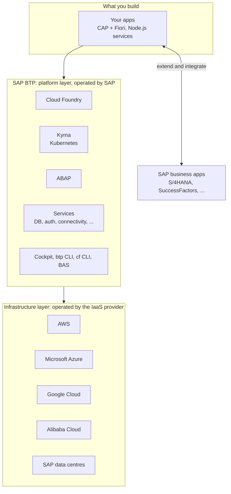
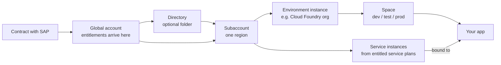
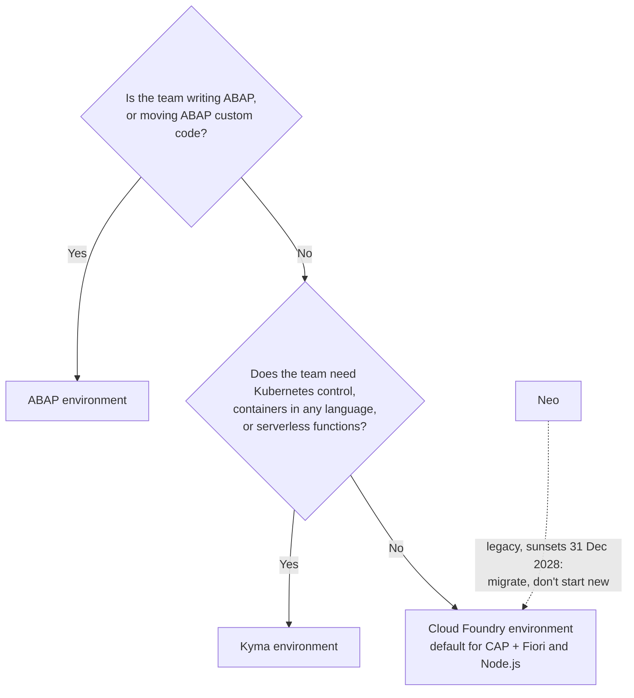

# M01 · What Is SAP BTP?

> **Level:** Foundation · **Study time:** ~2 h (lesson ~45 min · source reading ~30 min · hands-on ~30 min)
>
> **Prerequisites:** none. Start here.
>
> **After this module you can:** explain BTP in two sentences, name its environments and say which one your team uses, tell services from solutions, name the main tools and programming models, and give a first answer to "Why BTP and not just Azure or GCP?"

**Legend used in all lessons**
- 📄 = stated in this repo's documentation (a source link is given)
- 🌐 = general industry knowledge, **not** from this repo; verify before you rely on it, especially in front of a customer
- 🔁 = an analogy to something you already know (AWS / Python world). Useful for intuition, but not an exact equivalent.

---

## 1. In simple words

SAP Business Technology Platform (BTP) is **SAP's cloud platform for everything that sits around SAP's business applications** (S/4HANA, SuccessFactors, Ariba and so on).
Companies use it to **build new apps, extend SAP apps without modifying them, connect SAP and non-SAP systems, automate processes, and analyse data**.
BTP is **not** its own data centre business. It runs **on top of** AWS, Microsoft Azure, Google Cloud and Alibaba Cloud (and some SAP data centres). The hyperscaler runs the hardware, and SAP runs the platform on top.
Inside BTP you pick an **environment** to run your code: **Cloud Foundry** (your team's main one), **Kyma** (Kubernetes), or **ABAP**. **Neo** is legacy and shuts down at the end of 2028.
Everything your app needs (database, login, connectivity and so on) is consumed as a **service**, and what you're allowed to use is controlled by your **contract → entitlements → quotas**.
You manage it through the **BTP cockpit** (web UI), the **btp CLI** and the **cf CLI**, and you develop in **SAP Business Application Studio** (or VS Code), usually with **CAP**.

---

## 2. Core concepts

### 2.1 What BTP is for (the five portfolios)

📄 SAP describes BTP as integrating five technology portfolios ([source](../../btp-cloud-platform/docs/sap-business-technology-platform-6a2c1ab.md)):

| Portfolio | Plain meaning | Example you might meet |
|---|---|---|
| Application development | Build and extend apps | A CAP + Fiori app that adds a custom approval screen to S/4HANA |
| Process automation | Workflows and bots | An approval workflow, often low-code with SAP Build |
| Integration | Connect systems | Sending orders from S/4HANA to a non-SAP CRM |
| Data, analytics & enterprise planning | Data and reporting | Dashboards over S/4HANA data |
| Artificial intelligence | AI capabilities | AI features consumed as BTP services |

📄 The pitch behind it: SAP customers run end-to-end processes (lead to cash, source to pay, design to operate, hire to retire) across many SAP and non-SAP systems. BTP provides consistent "Suite Qualities" across them: one Fiori look and feel, one identity and SSO layer (SAP Cloud Identity Services), aligned data models and APIs, embedded analytics, one workflow inbox, and coordinated lifecycle management. The stated goal is a lower total cost of ownership.

🔁 **Analogy: a business park.** The hyperscalers own the land, power and water (infrastructure). SAP built a business park on that land with facilities designed specifically for SAP businesses: loading docks that connect straight into SAP systems, a shared security desk (identity), and the same signage everywhere (Fiori). You could build your own warehouse on bare land (go straight to AWS), but then you build the loading docks yourself.

### 2.2 The multi-cloud foundation: BTP runs on hyperscalers

📄 "Regions are provided either by SAP or by our IaaS partners AWS, Microsoft Azure, Google Cloud, and Alibaba Cloud. The third-party region providers operate the infrastructure layer of the regions, whereas SAP operates the platform layer and Cloud Foundry." ([Basic Platform Concepts](../../btp-cloud-platform/docs/10-concepts/basic-platform-concepts-73beb06.md))

That is why SAP calls it the **multi-cloud foundation**. This is the single most useful fact for the "BTP vs Azure/GCP" question: **it is usually "BTP *and* Azure", not "BTP *or* Azure."**

- A **region** is a geographic location (e.g. Europe/Frankfurt, US East). You choose **exactly one region per subaccount** (more in M02).
- ⚠️ The Basic Platform Concepts page says a region is "that is one data center". The [Regions](../../btp-cloud-platform/docs/10-concepts/regions-350356d.md) page is more precise: one region can contain several data centres and several CF environment instances. Trust the Regions page.

### 2.3 Services, solutions and applications

📄 ([Solutions and Services](../../btp-cloud-platform/docs/10-concepts/solutions-and-services-7613d9c.md), [Basic Platform Concepts](../../btp-cloud-platform/docs/10-concepts/basic-platform-concepts-73beb06.md))

- **Service** = a capability you consume rather than build. There are two types:
  - **Business services:** business-process or industry-specific functionality (for example, retrieving currency exchange rates).
  - **Technical services:** domain-independent building blocks (databases, authentication, messaging, logging…).
- **Key rule:** 📄 "On SAP BTP, all external dependencies such as databases, messaging systems, file systems, and so on, are **services**." Even environments and multitenant applications are treated as services.
- **Service plan** = a variant of a service, like a T-shirt size (e.g. a small vs large DB). Each plan has its own costs and benefits.
- **Solution** = a bigger packaged offering built from capabilities (e.g. SAP Build, SAP Integration Suite).
- **Your application** = the code you deploy (for example, a CAP app) that *consumes* services.
- The official catalogue of what exists, where and on which plan is the **SAP Discovery Center**, which is outside this repo.

🔁 For you (AWS background): a BTP *service* ≈ an AWS managed service (RDS, Cognito, SQS), and a *service plan* ≈ an instance class or tier.

### 2.4 Environments: where your code runs

📄 "Environments constitute the actual platform-as-a-service offering of SAP BTP… anchored on subaccount level." ([Environments](../../btp-cloud-platform/docs/10-concepts/environments-15547f7.md))

| Environment | What it is (📄) | Languages (📄 [Programming Languages](../../btp-cloud-platform/docs/10-concepts/programming-languages-730d82d.md)) | Who typically uses it |
|---|---|---|---|
| **Cloud Foundry** | Open-source PaaS: you push code, the platform builds and runs it using **buildpacks** | Java, Node.js, Python | Your team: CAP + Fiori apps, Node.js services |
| **Kyma** | Fully managed **Kubernetes** runtime based on the open-source Kyma project | Serverless Functions in Node.js/Python; microservices in **any** language | Teams wanting containers and Kubernetes control, event-driven extensions |
| **ABAP** | ABAP platform in the cloud (same release line as S/4HANA Cloud), each system with its own HANA Cloud DB | ABAP | ABAP developers moving custom code and extensions to the cloud |
| **Neo** *(legacy)* | SAP's original proprietary environment | HTML5, Java, HANA XS | Old customers only. **Sunsets 31 December 2028** (📄 SAP Note 3351844) |

- 📄 One **multi-environment subaccount** can host several environments, so users, authorizations and entitlements are managed once per subaccount (Neo is excluded from this).
- 📄 You **enable** an environment in a subaccount, which creates an **environment instance** (via cockpit, Service Marketplace, or `btp create accounts/environment-instance`).

🔁 Rough AWS mapping: Cloud Foundry ≈ Elastic Beanstalk / App Runner ("give me code, I run it"); Kyma ≈ EKS (managed Kubernetes); ABAP ≈ no AWS equivalent.

### 2.5 A first look at accounts, entitlements and money (detail in M02 and M03)

📄 ([Basic Platform Concepts](../../btp-cloud-platform/docs/10-concepts/basic-platform-concepts-73beb06.md))

- **Global account** = your company's **contract** with SAP. Entitlements arrive here.
- **Directory** = an optional folder for organizing subaccounts.
- **Subaccount** = where you actually deploy apps and use services. It lives in **one region**.
- **Space** (Cloud Foundry only) = a subdivision of a subaccount's CF org where development and deployment happen (e.g. `dev`, `test`).
- **Entitlement** = the right to use a particular *service plan*. **Quota** = how much of it.
- **Commercial models:** **consumption-based** (BTPEA, CPEA, Pay-As-You-Go: use any eligible service and pay for what you use) or **subscription-based** (a fixed price for the specific services you subscribed to).
- **Trial account** = free, for personal learning only, never production. **Enterprise account** = a real customer or partner contract.

🔁 Global account ≈ AWS Organization; subaccount ≈ an AWS account; entitlement ≈ license + service quota combined.

### 2.6 Users (detail in M04)

📄 **Platform users** = developers, admins and operators who work *on* BTP. **Business users** = people who *use* the apps deployed on BTP. Managing platform users' permissions is called **member management**. Managing business users' login and authorization is called **user management**.

### 2.7 Tools you will use

📄 ([Tools](../../btp-cloud-platform/docs/10-concepts/tools-abcae5b.md))

| Tool | What it's for | When you'll use it |
|---|---|---|
| **BTP cockpit** | Web admin UI for accounts, services, security, monitoring | Daily (M05) |
| **SAP Business Application Studio (BAS)** | Cloud IDE built on **Code-OSS** (the open-source base of VS Code), with SAP tooling for Fiori, CAP, HANA | Daily for CAP/Fiori (M11) |
| **cf CLI** | Deploy and manage apps **inside** Cloud Foundry | Daily (M07) |
| **btp CLI** | Manage the **account level**: global accounts, directories, subaccounts, entitlements, environment instances, subscriptions, users and authorizations | Often (M08) |
| **SAP Build** | Low-code/no-code apps, automations and sites | Sometimes |
| **Cloud Connector** | Secure link from BTP apps to **on-premise** systems | Projects with on-prem SAP (M17) |
| **Terraform provider for SAP BTP** | Infrastructure as Code for BTP resources | Advanced (M22) |
| **kubectl, kubelogin, Helm, Pack, Docker Desktop** | Kubernetes tooling for Kyma | Only if using Kyma (M24) |
| **SAP Cloud SDK** | Java/JS libraries for logging, multitenancy, connectivity | Inside your code |

⚠️ The docs describe the cf CLI as "used for managing subaccounts" and the btp CLI as "used for managing global accounts". That wording is loose. In practice the **btp CLI manages global accounts *and* subaccounts**, and the **cf CLI works inside a CF org and its spaces**. Remember it as: btp = account level, cf = inside Cloud Foundry.

### 2.8 Programming models: CAP vs ABAP Cloud

📄 ([Programming Models](../../btp-cloud-platform/docs/10-concepts/programming-models-042061d.md))

- **CAP (SAP Cloud Application Programming Model)** is a framework of languages, libraries and tools for enterprise services and apps in **Java (Spring Boot)** or **JavaScript/TypeScript (Node.js)**. SAP lists these benefits: built-in best practices, support for VS Code and BAS, "no runtime lock-in", reuse of BTP services. **This is what your team uses.**
- **ABAP Cloud** is the modern, cloud-ready way to write ABAP, using only **released APIs** so custom code stays separate from SAP code and upgrades are easier. It's used in the ABAP environment.

🔁 For you: CAP feels a bit like FastAPI + SQLAlchemy + Pydantic rolled into one opinionated framework. You declare the data model and service in **CDS**, and CAP gives you a working OData/REST API, DB deployment and auth hooks.

### 2.9 APIs and platform constraints

- 📄 **SAP Business Accelerator Hub** (formerly SAP API Business Hub) is the central catalogue of SAP APIs (REST, OData), where you can try them with mock data. **API Management** (in SAP Integration Suite) is for publishing and managing *your own* APIs. ([APIs](../../btp-cloud-platform/docs/10-concepts/apis-d1d1107.md))
- 📄 Apps on BTP are exposed **only via HTTPS**. Plain HTTP is not allowed. Browsers must support **TLS 1.2+**. ([Prerequisites and Restrictions](../../btp-cloud-platform/docs/10-concepts/prerequisites-and-restrictions-e6ddaef.md))

---

## 3. Diagrams

### 3.1 The BTP layer cake



### 3.2 From contract to running app (preview of M02 and M03)



### 3.3 First-look environment chooser (full version in M18)



---

## 4. Hands-on (~30 min, Windows)

The goal is to look around and prepare your machine. You'll create the trial account in M02.

**Step 1: browse the service catalogue (10 min).** Open the SAP Discovery Center (linked from [Solutions and Services](../../btp-cloud-platform/docs/10-concepts/solutions-and-services-7613d9c.md)) and find these three services. For each, note one service plan and one region where it's available:
- SAP Authorization and Trust Management service (XSUAA)
- SAP HANA Cloud
- Cloud Foundry Runtime

**Step 2: check your machine (10 min).** Open **PowerShell** and run each command. Write down the versions in `progress.md` → M01 → Hands-on log.

```powershell
node -v
```
```powershell
npm -v
```
```powershell
git --version
```
```powershell
cf version
```
```powershell
btp --version
```

- `node` and `git` should print versions. If they don't, ask IT; you'll need both from M10 onwards.
- `cf` and `btp` will most likely fail with *"not recognized as the name of a cmdlet"*. **That's expected.** You'll install them in M07 and M08. If your company laptop needs IT approval for installs, raise the request now.
- 🌐 If `npm` fails with *"running scripts is disabled on this system"*, that's the PowerShell execution policy. Run `npm.cmd -v` instead, or ask IT. Don't change security settings on a company laptop yourself.

**Step 3: glossary drill (10 min).** Open the [Glossary](../../btp-cloud-platform/docs/glossary-e67a143.md) and look up: *entitlement*, *quota*, *subaccount*, *service plan*, *environment instance*. Write each definition in your own words in your notes.

---

## 5. Common mistakes & gotchas

1. **"BTP competes with AWS/Azure as a cloud."** No. BTP runs *on* them (📄). It competes, if anything, with building your own SAP integration layer on raw cloud services.
2. **Mixing up environment and region.** The *region* is **where** (Frankfurt, US East). The *environment* is **how your code runs** (CF, Kyma, ABAP). A subaccount has one region and can have several environments.
3. **Starting anything new on Neo.** Neo sunsets **31 Dec 2028** (📄). Note that the Neo concept page itself doesn't state the date; it's in Basic Platform Concepts.
4. **Using a trial account for team or production work.** 📄 Trials are for personal exploration only, with restricted resources.
5. **Confusing the CLIs.** `btp` = account level (subaccounts, entitlements, role collections). `cf` = inside a Cloud Foundry org and space (apps, service instances).
6. **"CDS" means two different things.** CAP uses **CDS** (Core Data Services) for models and services, and ABAP also has **ABAP CDS** views. They're related ideas but different technologies. Say which one you mean.
7. **Thinking BAS is a different editor to learn.** BAS is built on Code-OSS, so it feels like VS Code with SAP extensions and preconfigured dev spaces.
8. **Expecting HTTP to work.** 📄 BTP only exposes apps over HTTPS.
9. **Trusting every page equally.** 📄 "Prerequisites and Restrictions" still says the Java tools were tested with Java 7 and 8. That's clearly outdated, so check the current runtime versions in the buildpack docs (M10, M27).

---

## 6. Interview Q&A (fresher level)

**Q1. What is SAP BTP, in one or two sentences?**
It's SAP's cloud platform that brings together app development, integration, process automation, data and analytics, and AI. Companies use it to build new apps and to extend and connect their SAP systems without modifying the SAP core.

**Q2. Is BTP infrastructure like AWS or Azure?**
No. BTP is a platform layer that runs *on* hyperscalers: AWS, Azure, Google Cloud, Alibaba Cloud and some SAP data centres. The provider runs the infrastructure and SAP runs the platform and Cloud Foundry on top.

**Q3. What environments does BTP offer?**
Cloud Foundry, Kyma and ABAP, plus the legacy Neo environment, which sunsets at the end of 2028. CF is a code-push PaaS for Java, Node.js and Python. Kyma is managed Kubernetes. ABAP is the ABAP platform in the cloud.

**Q4. Which environment does your team use, and why?**
Cloud Foundry, because we build CAP + Fiori apps and Node.js services. CF lets us push code and let buildpacks handle the runtime, and the CAP, App Router and MTA tooling are built around it. We don't need the extra control (and extra operations work) that Kubernetes on Kyma brings.

**Q5. What's the difference between a service and a service plan?**
A service is a capability you consume, like a database or the authorization service. A plan is a variant of it with its own size, features and cost, like T-shirt sizes. You get entitled to plans, not just services.

**Q6. Business services vs technical services?**
Business services give business-process or industry functionality, like currency exchange rates. Technical services are generic building blocks such as databases, authentication or messaging.

**Q7. What is CAP?**
SAP's Cloud Application Programming Model. It's a framework for building enterprise services and apps in Node.js or Java: you define data models and services in CDS, and it handles a lot of boilerplate such as OData APIs, DB deployment and auth integration.

**Q8. Name some BTP tools and what they're for.**
The cockpit is the web admin UI. Business Application Studio is the IDE. The cf CLI manages apps in Cloud Foundry. The btp CLI manages accounts, entitlements and users. Cloud Connector links BTP to on-premise systems. The Terraform provider is for Infrastructure as Code.

**Q9. Where would you find which services are available in which region?**
In the SAP Discovery Center service catalogue. The documentation itself points there.

**Q10. What are the two commercial models?**
Consumption-based (BTPEA, CPEA or Pay-As-You-Go), where you can use any eligible service and pay for usage. Subscription-based, where you pay a fixed price for the specific services you subscribed to.

**Q11. Platform user vs business user?**
Platform users are developers and admins who work on BTP itself. Business users are the people who use the apps we deploy.

**Q12. What's the Neo environment, and should we use it?**
It's SAP's original proprietary environment, and it sunsets on 31 December 2028. New work goes to the multi-cloud foundation (CF, Kyma, ABAP), and existing Neo apps should be migrated.

---

## 7. Customer questions (delivery & presentation)

> **Answer pattern:** recommendation → reason → trade-off → evidence. Never guess at pricing, roadmap or contract terms in front of a customer. Say you'll confirm.

**C1. "We already run on Azure. Why do we need BTP? Why not build everything on Azure directly?"**
- **Recommendation:** you don't have to choose. BTP runs on Azure (and AWS and Google Cloud), so you can keep your hyperscaler strategy and use BTP for the SAP-specific layer.
- **Reason:** 📄 BTP's value is the SAP-specific layer. That means consistent integration with your SAP processes, one Fiori user experience, shared identity and SSO across SAP solutions, and aligned SAP data models and APIs. 🌐 Building that layer yourself on raw Azure services usually means more integration code to write and maintain whenever SAP systems change.
- **Trade-off (be honest):** 🌐 for workloads that have nothing to do with SAP data or processes, or where you already have a strong Azure platform team and tooling, building directly on Azure can be the better fit. BTP shines where SAP is involved.
- **Evidence:** 📄 regions are run by AWS, Azure, Google Cloud, Alibaba or SAP ([Regions](../../btp-cloud-platform/docs/10-concepts/regions-350356d.md)); 📄 Suite Qualities ([BTP overview](../../btp-cloud-platform/docs/sap-business-technology-platform-6a2c1ab.md)). The full answer is in M18.

**C2. "What exactly are we buying when we buy BTP?"**
- 📄 A **global account**, which represents your contract with SAP. It holds **entitlements** (the service plans you may use) and **quotas** (how much of them). You then hand these out to **subaccounts** where teams build and run apps.
- 📄 You choose a **commercial model**: consumption-based (BTPEA, CPEA, Pay-As-You-Go: flexible, pay for use) or subscription-based (fixed cost for specific services).
- Don't quote prices. 🌐 Pricing depends on the contract, so say "our licensing contact will confirm."

**C3. "Can we decide where our data and apps are hosted?"**
- 📄 Yes. Each **subaccount** is created in **one region** that you choose, such as a European region. Regions are run by SAP or by AWS, Azure, Google Cloud or Alibaba Cloud.
- 📄 If your contract includes **EU Access**, you pick a provider and region that support it. Note that some services don't support EU Access even where the region does.
- Detail in M02.

**C4. "We still have apps on Neo. Do we need to act?"**
- 📄 Yes. The Neo environment **sunsets on 31 December 2028** (subject to contract terms; SAP Note 3351844). SAP publishes a migration guide to the multi-cloud foundation (Cloud Foundry/Kyma).
- Recommendation: plan the migration now rather than close to the deadline. 🌐 Neo-to-CF moves often involve re-architecting (for example, from monoliths to microservices), so they take time.

**C5. "Will we be locked into SAP?"** *(first look; full answer in M18)*
- 📄 Cloud Foundry and Kyma are based on **open-source** projects, and SAP states that CAP brings "**no runtime lock-in**".
- 🌐 Honest caveat: SAP-specific services (XSUAA, Destination service, HANA Cloud features) do create some dependency. The usual mitigation is to keep business logic in standard languages (Node.js/Java) and wrap SAP-specific services behind clear interfaces.

**C6. "Is it secure out of the box?"** *(first look; detail in M04, M15, M21)*
- 📄 Applications are only reachable over **HTTPS**, and older protocols (TLS 1.1 and below, SSL 3.0, RC4) are not supported. Authentication and authorization go through SAP's identity services.
- Security is shared, though: SAP secures the platform, and your team secures the app (roles, scopes, data handling).

---

## 8. Quick quiz

1. Who operates the infrastructure layer of a BTP region hosted on Azure, and who operates the platform layer?
2. Name the three current BTP environments and the one being retired, with its sunset date.
3. True or false: "A subaccount can be in several regions at once."
4. Which CLI would you use to create a subaccount, and which to deploy a Node.js app into a space?
5. What is the difference between an entitlement and a quota?

<details>
<summary>Answers</summary>

1. Microsoft runs the infrastructure layer, and SAP runs the platform layer (and Cloud Foundry).
2. Cloud Foundry, Kyma and ABAP are current. Neo sunsets on 31 December 2028.
3. False. Each subaccount has exactly one region. To deploy in several regions you use several subaccounts and deploy to each.
4. The btp CLI to create a subaccount. The cf CLI to deploy into a space (`cf push` or `cf deploy`).
5. An entitlement is the *right* to use a particular service plan. A quota is the *amount* of that plan you're allowed to consume.

</details>

---

## 9. Sources

Core pages this lesson is based on, all in `btp-cloud-platform/docs/`:
- [SAP Business Technology Platform](../../btp-cloud-platform/docs/sap-business-technology-platform-6a2c1ab.md): the five portfolios, Suite Qualities, Neo migration pointer
- [Basic Platform Concepts](../../btp-cloud-platform/docs/10-concepts/basic-platform-concepts-73beb06.md): multi-cloud foundation, environments, **Neo sunset date**, accounts, commercial models, users
- [Solutions and Services](../../btp-cloud-platform/docs/10-concepts/solutions-and-services-7613d9c.md): business vs technical services
- [Environments](../../btp-cloud-platform/docs/10-concepts/environments-15547f7.md): multi-environment subaccounts, environment instances
- [Tools, Programming Models, Programming Languages, and APIs](../../btp-cloud-platform/docs/10-concepts/tools-programming-models-programming-languages-and-apis-9b15170.md) (landing page)
- [Tools](../../btp-cloud-platform/docs/10-concepts/tools-abcae5b.md)
- [Programming Models](../../btp-cloud-platform/docs/10-concepts/programming-models-042061d.md): CAP and ABAP Cloud
- [Programming Languages](../../btp-cloud-platform/docs/10-concepts/programming-languages-730d82d.md)
- [APIs](../../btp-cloud-platform/docs/10-concepts/apis-d1d1107.md)
- [Prerequisites and Restrictions](../../btp-cloud-platform/docs/10-concepts/prerequisites-and-restrictions-e6ddaef.md)

Also referenced: [Regions](../../btp-cloud-platform/docs/10-concepts/regions-350356d.md) (core in M02) and the [Glossary](../../btp-cloud-platform/docs/glossary-e67a143.md).

**⚠️ Doc issues found while writing this lesson**
- *Prerequisites and Restrictions* says the Java tools were "tested with Java 7, and Java 8". That's outdated.
- *Basic Platform Concepts* equates a region with "one data center", but *Regions* says a region can contain several data centres.
- The Neo sunset date (31 Dec 2028) appears in *Basic Platform Concepts* but not on the *Neo Environment* page itself.
- The *Tools* page describes cf CLI scope as "managing subaccounts" and btp CLI as "managing global accounts". That's loose wording; see gotcha 5.

**Not covered by this repo (go here next):** the SAP Discovery Center service catalogue (services, plans, regions, pricing), and capire for CAP in depth (M11).
